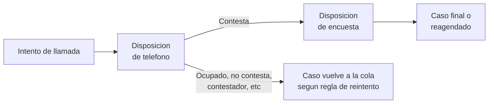

# Diccionario de disposiciones — INVOKE 2

Nov 18, 2026 · @Equipos

## Propósito

Este documento define **qué significa cada código de disposición** en INVOKE 2. Es la referencia que la implementación lee literalmente y contra la que se validan los reportes.

No es parte del PRD. El PRD se lee una vez al arrancar; este documento se consulta cada vez que alguien discute un número.

### Por qué existe

Un sistema CATI sin definiciones escritas deja cada criterio librado a la implementación: qué cuenta como contacto, qué entra en el denominador de una tasa, cuándo un caso se da por cerrado. Dos reportes construidos en momentos distintos pueden entonces diferir sin que nadie pueda decir cuál es el correcto.

Con este documento, un reporte nunca está "mal": tiene una definición, que se puede auditar y, si corresponde, discutir y cambiar.

### Quién lo firma

Investigación y sistemas, en conjunto. Investigación manda en qué significa cada código y cómo entra en los cálculos; sistemas manda en que sea implementable sin ambigüedad.

### Quién lo consume

| Consumidor | Para qué |
| --- | --- |
| Implementación de INVOKE 2 | Códigos, comportamientos y reglas de reintento |
| Motor de reportes | Qué código entra en qué numerador y denominador |
| Vista de compatibilidad CDR | Tabla de equivalencias con el vocabulario viejo |
| Capacitación de encuestadores | Qué elegir en cada situación |
| Informes a clientes | Respaldo metodológico de las tasas declaradas |

### Versionado

Cada cambio lleva número de versión, fecha y motivo. **Un reporte histórico se recalcula con la versión del diccionario vigente cuando se levantó el estudio**, no con la última. De lo contrario, reabrir un estudio viejo cambia sus números.

El estudio guarda qué versión del diccionario usó.

### Estado

**Versión 1.** Los catálogos parten de los códigos que usó INVOKE legacy en producción, con sus etiquetas originales en español, más los códigos nuevos que el modelo actual exige. Las decisiones de la última sección están tomadas.

Queda pendiente llenar la columna de equivalencias con el vocabulario de la solución actual, que no bloquea la implementación del catálogo sino la vista de compatibilidad.

## Los dos ejes

Cada intento de llamada produce **dos disposiciones independientes**, no una. Esta separación viene del legacy y se conserva porque es correcta.

| Eje | Responde a | Quién la determina |
| --- | --- | --- |
| **Disposición de teléfono** | ¿Qué pasó con la línea? | El sistema, por los eventos de telefonía |
| **Disposición de encuesta** | ¿Qué pasó con el caso? | El encuestador, al clasificar |

Un teléfono que contesta puede terminar en encuesta completa, rechazo, agenda o fuera de cuota. Un teléfono ocupado no produce ninguna disposición de encuesta: el caso sigue disponible.

### Dos conceptos que no hay que confundir

**Disposición del intento** contra **disposición del caso.** El legacy guardaba ambas en `Phonecall` y en `PhoneSurvey`, y eso está bien: un caso puede acumular ocho intentos "no contesta" y terminar en "completa". El intento registra lo que pasó esa vez; el caso registra dónde quedó.

**En INVOKE 2 ninguna de las dos es un campo que se sobrescribe.** Ambas se derivan del log de eventos. La última disposición del caso es una consulta, no una columna que alguien actualiza y que puede quedar desincronizada.

### Comportamientos

Cada disposición declara qué hace el sistema después de aplicarla. El legacy definía cuatro y se conservan:

| Código | Comportamiento | Qué hace |
| --- | --- | --- |
| 10 | Continúa | El caso sigue en curso o vuelve a la cola |
| 20 | Termina | El caso se cierra con esta disposición |
| 21 | Termina y explica | Se cierra y pide al encuestador un texto de motivo |
| 22 | Termina y agenda | Se cierra este intento y abre un reagendamiento |

## Catálogo de disposiciones de teléfono

Los nueve códigos que INVOKE legacy usó en producción, con sus etiquetas originales. Son el punto de partida, no la versión final.

| Código | Etiqueta | Comportamiento | Estado | Cuenta como intento |
| --- | --- | --- | --- | --- |
| 1 | Aun no llamado | Continúa | Inicial | No |
| 2 | Llamada en curso | Continúa | Transitorio | No |
| 3 | Ocupado | Termina | Reintentable | Sí |
| 4 | Contesta | Continúa | Habilita encuesta | Sí |
| 5 | No volver a llamar | Termina | Final | Sí |
| 6 | No contesta | Termina | Reintentable | Sí |
| 7 | Fuera de servicio | Termina | Reintentable | Sí |
| 8 | Desconectado | Termina | Reintentable | Sí |
| 9 | Contestador telefónico verificado | Termina | Reintentable | Sí |

### Notas sobre códigos puntuales

**1 y 2 no son disposiciones reales**: son estados internos del caso. No deberían aparecer en ningún reporte de resultados de llamada, y hoy en el legacy aparecen porque viven en la misma tabla. En INVOKE 2 conviene marcarlos explícitamente como estados y no como disposiciones, para que ningún reporte los sume por accidente.

**4 "Contesta" es la única que habilita una disposición de encuesta.** Todas las demás cierran el intento sin que haya habido entrevista.

**5 "No volver a llamar" es lista negra permanente** y sobrevive al estudio: el número no se vuelve a discar aunque aparezca en otra muestra. La exclusión es transversal a toda la casa: el número no se vuelve a discar en ningún estudio, no solo en el que la originó.

**7 "Fuera de servicio" y 8 "Desconectado" están marcados como reintentables**, con esperas largas. Vale revisar si corresponde: un número fuera de servicio rara vez vuelve, y reintentarlo gasta muestra. Es una de las decisiones abiertas del final.

**9 "Contestador telefónico" depende del detector automático (AMD)**, que se equivoca. Un humano clasificado como contestador recibe un corte en la cara y queda registrado como contestador: ver el código nuevo de falso positivo en la sección siguiente.

## Catálogo de disposiciones de encuesta

Los doce códigos que el legacy tenía cargados en producción, más los seis estados extendidos que usó para operativos mixtos. Las etiquetas son las originales.

### Disposiciones principales

| Código | Etiqueta | Comportamiento | Final | Categoría |
| --- | --- | --- | --- | --- |
| 1 | Disponible | Continúa | No | Disponible |
| 2 | En Progreso | Continúa | No | En Progreso |
| 3 | Completa | Continúa | Sí | Completa |
| 4 | Rechazada | Termina | Sí | Rechazada |
| 5 | Agendada | Termina y agenda | No | Agendada |
| 6 | Fuera de Cuota | Termina | Sí | Fuera de Cuota |
| 7 | Interrumpida | Termina y explica | Sí | Interrumpida |
| 8 | No cumple condición | Termina y explica | Sí | Interrumpida |
| 20 | Filtrada | Termina y explica | Sí | Interrumpida |
| 21 | Fallecido | Termina | Sí | Interrumpida |
| 22 | No es un hogar | Termina | Sí | Interrumpida |
| 50 | No aplica | Termina y explica | Sí | Interrumpida |

### Estados extendidos para operativos mixtos

El legacy los usaba cuando la encuesta telefónica era la primera etapa de un operativo presencial o de un re-contacto.

| Código | Etiqueta | Para qué servía |
| --- | --- | --- |
| 13 | Coordinada | Terminó la fase telefónica, espera la presencial |
| 14 | Descargada para presencial | El caso se bajó al operativo de campo |
| 15 | Recall | Hay que rehacerla sin las respuestas anteriores |
| 16 | Retomar | Hay que rehacerla conservando las respuestas |
| 17 | Retomada | Ya se rehizo conservando las respuestas |
| 18 | Corregir | La entrevista necesita corrección |

### La categoría agrupa lo que el código ya distingue

Cada situación tiene su propio código y eso está bien: *Fuera de Cuota* para el caso que el diseño descarta, *No es un hogar* y *Fallecido* para la unidad que no pertenecía a la población, *Interrumpida* para cuando el encuestador corta la entrevista en curso. El catálogo no necesita códigos nuevos acá.

El problema está un nivel más arriba. El legacy agrupaba seis de esas disposiciones bajo la misma **categoría** — Interrumpida — y los reportes leen la categoría, no el código. Eso mezcla cosas que no son lo mismo para el cálculo:

- **Fallecido** y **No es un hogar**: la unidad **no era elegible**, no pertenecía a la población objetivo.
- **Fuera de Cuota**, **Filtrada** y **No cumple condición**: la unidad **sí era elegible** y además cooperó; fue el diseño el que la descartó.
- **Interrumpida**: hubo una **entrevista parcial** que el encuestador cortó.

Esa distinción decide si el caso entra o no en el denominador de la tasa de respuesta. Como la categoría del legacy no la refleja, **INVOKE 2 no reutiliza ese agrupamiento**: cada disposición declara explícitamente su grupo de cálculo, y los reportes leen ese grupo.

## Códigos nuevos

INVOKE 2 opera en modos que el legacy no tenía — power, predictivo, discado manual a números fuera de muestra — y esos modos producen situaciones que el catálogo viejo no sabe nombrar.

### Disposiciones de teléfono nuevas

| Código | Etiqueta propuesta | Qué registra | Por qué hace falta |
| --- | --- | --- | --- |
| 30 | Abandonada por el sistema | El respondente atendió y no había encuestador disponible | Sin este código no se puede medir ni controlar el abandono en power y predictivo |
| 31 | Contestador telefónico detectado por el sistema\
 | El sistema clasificó la llamada como contestador y cortó | Separa el corte automático del contestador verificado |
| 32 | Falso positivo de contestador | Revisión posterior confirmó que era una persona | Permite medir el error del AMD y sumarlo al daño real |

**30 es el código más importante de este documento.** Una llamada abandonada no es una molestia operativa: quema un caso de la muestra de forma irreversible, porque la persona atendió, escuchó silencio, y la próxima vez no atiende. Tiene que tener su propio código y entrar en el cálculo de la tasa de respuesta.

**31 y 32 existen porque el AMD se equivoca.** El código 9 del catálogo viejo mezcla "contestador confirmado" con "el detector dijo contestador". Separarlos permite calibrar: se toma una muestra de llamadas con código 31, alguien las escucha, y las que eran personas se reclasifican como 32. La proporción de 32 sobre 31 es la tasa de error del detector, y se suma al abandono para conocer el daño real.

Sin esta separación, el tablero muestra una tasa de abandono optimista y nadie se entera.

### Origen del caso

No es una disposición sino un atributo del caso, definido en ADR-008 del PRD. Se documenta acá porque condiciona los cálculos.

| Valor | Qué significa | Entra al denominador del marco |
| --- | --- | --- |
| `marco` | Estaba en la muestra original | Sí |
| `derivado` | Lo pasó otro contacto durante el trabajo de campo | No |
| `reemplazo_manual` | El encuestador lo agregó a mano | No |
| `lista_externa` | Vino de una lista cargada aparte | No |

Un caso que no estaba en el marco no tenía probabilidad conocida de selección. Si se mezcla con la muestra original, la tasa de respuesta queda mal calculada y las ponderaciones también.

### Llamada administrativa

Tercer tipo de registro: llamadas que no son intentos de entrevista — coordinación, verificación de una entrevista ya hecha, supervisión, concertación de cita.

No producen disposición de encuesta y **no cuentan como intento de contacto**. Quedan solo en el log de tiempos, para el cálculo de productividad del encuestador.

Hoy estas llamadas se cuelan como intentos y ensucian la contactabilidad.

## Reglas de reintento

Cada disposición reintentable define cuánto espera el caso antes de volver a la cola. Los valores de partida son los que INVOKE legacy tenía parametrizados por estudio.

| Disposición | Espera legacy | Tope de intentos | Ventana horaria |
| --- | --- | --- | --- |
| Ocupado | 30 min | A definir | Misma franja |
| No contesta | 120 min | A definir | Rotar franja |
| Contestador telefónico | 120 min | A definir | Rotar franja |
| Fuera de servicio | 180 min | A definir | Cualquiera |
| Desconectado | 180 min | A definir | Cualquiera |
| Abandonada por el sistema | A definir | A definir | A definir |
| Contestador telefónico detectado por el sistema | A definir | A definir | A definir |

Los valores del legacy son el resultado de años de operación y conviene respetarlos salvo que haya evidencia en contra. Son configurables por estudio, no constantes del sistema.

### Lo que el legacy no tenía y hace falta

**Tope de intentos.** El legacy no limitaba cuántas veces se reintentaba un caso; dependía de que el estudio se cerrara. Un tope explícito por disposición es necesario para calcular la tasa de respuesta: un caso con el tope alcanzado es un **no-contacto definitivo**, que es una categoría distinta de un caso que simplemente no llegó a trabajarse.

**Rotación de franja horaria.** Reintentar ocho veces un "no contesta" en la misma franja es tirar intentos. La regla razonable es que cada reintento de no-contacto caiga en una franja distinta de la anterior. Esto conecta con el protocolo de franjas que el tablero de productividad ya controla.

**Tratamiento de la abandonada.** Un caso que el sistema abandonó merece un tratamiento propio: la persona ya quedó molesta. Las opciones son esperar más que lo habitual, asignarlo a discado preview para que lo tome un encuestador con el caso ya en pantalla, o directamente no reintentarlo. Es decisión de investigación.

**Los tres son parámetros del estudio, no constantes del sistema.** Espera por disposición, tope de intentos y rotación de franja se configuran desde la administración de cada estudio, con valores por defecto heredados. Este documento define sus valores recomendados; el sistema debe permitir cambiarlos sin tocar código.

### Reintento tras abandono, una advertencia

Si el sistema abandona una llamada y después reintenta el mismo número en modo predictivo, puede volver a abandonarla. Dos abandonos sobre la misma persona no son dos incidentes independientes: son un caso que se destruyó a sí mismo.

La regla mínima: **un caso con una abandonada previa nunca vuelve a la cola en modo predictivo**, solo en power con N bajo o en preview.

## Equivalencias con el vocabulario actual

Mientras INVOKE 2 y la solución actual convivan, el tablero de productividad lee de las dos fuentes y las muestra juntas (ADR-009 del PRD). Para eso cada código nuevo necesita su equivalente en el vocabulario viejo, **o la marca explícita de que no lo tiene**.

En el CDR actual las dos disposiciones viajan juntas en un mismo campo, separadas por una barra vertical. Esta tabla mapea de INVOKE 2 hacia esos valores.

### Para completar

#### Disposiciones de teléfono

| Código | Etiqueta INVOKE 2 | Valor equivalente en el CDR actual |
| --- | --- | --- |
| 3 | Ocupado |  |
| 4 | Contesta |  |
| 5 | No volver a llamar |  |
| 6 | No contesta |  |
| 7 | Fuera de servicio |  |
| 8 | Desconectado |  |
| 9 | Contestador telefónico verificado |  |
| 30 | Abandonada por el sistema | Sin equivalente |
| 31 | Contestador telefónico detectado por el sistema | Sin equivalente |
| 32 | Falso positivo de contestador | Sin equivalente |

#### Disposiciones de encuesta

| Código | Etiqueta INVOKE 2 | Valor equivalente en el CDR actual |
| --- | --- | --- |
| 3 | Completa |  |
| 4 | Rechazada |  |
| 5 | Agendada |  |
| 6 | Fuera de Cuota |  |
| 7 | Interrumpida |  |
| 8 | No cumple condición |  |
| 20 | Filtrada |  |
| 21 | Fallecido |  |
| 22 | No es un hogar |  |
| 50 | No aplica |  |

Para llenar la tercera columna alcanza con listar los valores distintos del campo de disposición en el CDR, sobre los estudios reales y excluyendo las campañas que no son estudios.

### Dos reglas sobre el mapeo

**Los códigos sin equivalente se muestran como tales.** No se mapean a la fuerza a algo parecido. Si en el tablero unificado un estudio de INVOKE 2 tiene abandonadas y los de la solución vieja no, eso debe verse como una columna que el sistema viejo no podía medir, no como un cero.

**El mapeo es de ida solamente.** Va de INVOKE 2 hacia el vocabulario viejo, para poder mostrar los dos lados juntos. No se usa para traducir datos históricos hacia el modelo nuevo: los estudios viejos se quedan con sus propios códigos y su propia versión del diccionario.

La tabla se retira junto con la vista de compatibilidad, el día que no quede ningún estudio en el sistema anterior.

## Decisiones tomadas

Los nueve puntos que este documento dejó planteados, con su resolución. Se registran acá porque la implementación y los reportes los leen literalmente, y porque un cambio futuro necesita saber qué se decidió y cuándo.

1. **Asignar cada disposición de encuesta a su grupo de cálculo: entrevista, elegible sin entrevista, no elegible o elegibilidad desconocida. Las disposiciones ya existen por separado en el catálogo; lo que falta es declarar en qué grupo entra cada una**. Sin esto no se puede calcular bien ninguna tasa.
2. **Tratamiento del caso abandonado**: la espera es un parámetro configurable por estudio. Falta definir su valor por defecto y en qué modo de discado puede volver el caso.
3. **Tope de intentos por disposición**: configurable por estudio, con tope global por caso y tope por franja horaria. Define cuándo un caso pasa a no-contacto definitivo. Falta definir los valores por defecto.
4. **Fuera de servicio y desconectado**: reintentables, con tiempo de espera configurable por estudio. Falta definir el valor por defecto; el legacy usaba tres horas.
5. **Persistencia de la lista negra entre estudios**: resuelto. Vale para todos los estudios de la casa, no solo para el que la originó.
6. **Una entrevista parcial, ¿cuándo cuenta como completa?** Resuelto: queda parcial. No hay umbral automático; solo pasa a completa si un supervisor le cambia el estado desde el panel de control, y ese cambio queda registrado con autor, motivo y marca de tiempo.
7. **Casos fuera de marco y cuotas**: resuelto. El caso derivado \*\*sí cuenta para la cuota\*\*, porque la cuota se mide sobre la población lograda. Sigue sin entrar al denominador de la tasa de respuesta, que es un cálculo distinto.
8. **Valor `lista_externa` en el origen del caso**: ¿entra al denominador del marco o no? Resuelto: es un agregado, no parte del diseño, así que no entra al denominador del marco y se declara aparte, como el resto de los casos fuera de marco.
9. **Estados extendidos para operativos mixtos**: ¿se conservan los seis del legacy, o se rediseñan? Resuelto: por ahora se conservan los seis. Se revisan cuando se encare el multimodo en la Fase 4.

### Cómo se cierra

La única clasificación que sigue abierta — si *Filtrada* y *No cumple condición* son no elegibles o elegibles descartados — se trata en el documento de fórmulas, porque afecta denominadores y no el catálogo. Acá ambos códigos existen y están definidos.

### Nota de implementación

Los códigos 1 y 2 de ambos catálogos — Aun no llamado, Llamada en curso, Disponible, En Progreso — son estados internos y no disposiciones. En INVOKE 2 se modelan aparte y no aparecen en ningún reporte de resultados. Eso es decisión de sistemas y ya está tomada.
