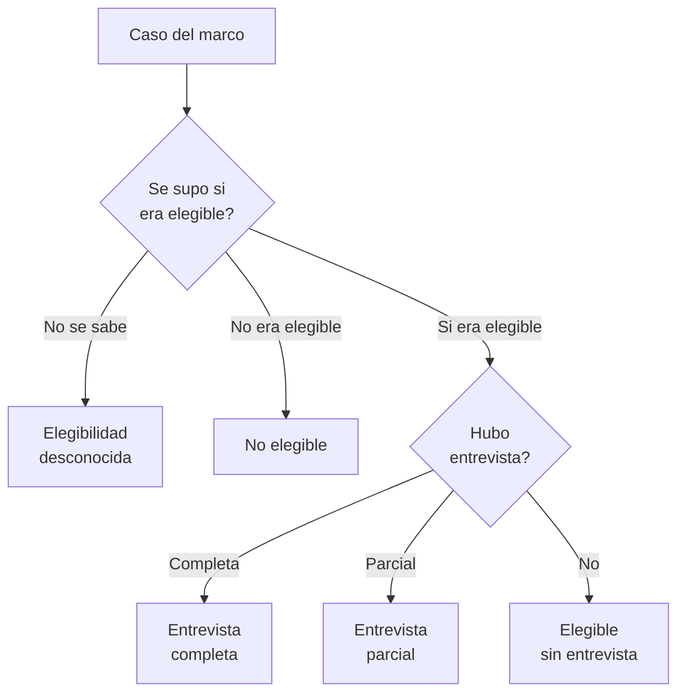

# Fórmulas de reporte y mapeo AAPOR — INVOKE 2

Nov 18, 2026 · @Equipos

## Propósito

Este documento define **cómo se calcula cada tasa** que INVOKE 2 reporta: qué va en el numerador, qué va en el denominador, y qué casos quedan afuera.

Es el complemento del diccionario de disposiciones. El diccionario dice qué significa cada código; este documento dice qué se hace con él.

### Dependencia

**E**l diccionario de disposiciones ya está en versión 1. Estas cinco de sus decisiones son las que definen denominadores acá:

| Decisión del diccionario | Resolución | Qué fórmula afecta |
| --- | --- | --- |
| Asignar cada disposición a su grupo de cálculo | Resuelta en la sección siguiente | Todos los denominadores |
| Tope de intentos por disposición | Configurable por estudio, global y por franja; falta el valor por defecto | Tasa de contacto y de respuesta |
| Cuándo una parcial cuenta como completa | Queda parcial salvo que un supervisor la promueva desde el panel | Tasa de respuesta y cooperación |
| Casos fuera de marco y cuotas | Cuentan para cuota, no para la tasa de respuesta | Avance de cuotas |
| Tratamiento de `lista_externa` | Es un agregado, queda fuera del marco | Tasa de respuesta |

**Nada del diccionario bloquea ya este documento.**

Lo que sigue está escrito con las variantes posibles según cómo se resuelva cada una, para que la reunión con investigación tenga las opciones sobre la mesa.

### El principio que ordena todo

Ningún número sale de un contador. Toda tasa es una consulta sobre el log de eventos, con una definición escrita acá y versionada.

Eso significa que un reporte nunca está "mal": tiene una definición, que se audita y, si hace falta, se discute y se cambia con número de versión nuevo.

### Quién lo firma

Investigación define; sistemas verifica que sea calculable sin ambigüedad. Las fórmulas que se declaran a clientes tienen que poder defenderse metodológicamente frente a otro proveedor.

### Estado

Versión 1. El diccionario de disposiciones también está en versión 1. Las siete decisiones que este documento planteó están tomadas y registradas al final.

## Clasificación de casos

Antes de cualquier fórmula hay que clasificar cada caso del marco en uno de cuatro grupos. **Este paso es el que decide todos los denominadores**, y es donde se originan casi todas las discusiones sobre reportes.



### Los cuatro grupos

| Grupo | Qué incluye | Disposiciones del diccionario |
| --- | --- | --- |
| **Entrevistas** | Completas, incluidas las parciales que un supervisor promovió | Completa |
| **Elegibles sin entrevista** | Hubo contacto o se sabe que correspondía entrevistar, pero no se logró | Rechazada; Agendada sin cierre; Interrumpida no promovida; Fuera de Cuota; Abandonada por el sistema |
| **No elegibles** | La unidad no pertenecía a la población objetivo | Fallecido; No es un hogar; Filtrada; No cumple condición |
| **Elegibilidad desconocida** | Nunca se supo si correspondía entrevistar | No contesta con tope alcanzado; Contestador telefónico; Fuera de servicio; Desconectado; No volver a llamar |

### Las tres reglas que quedaron fijadas

**Filtrada y No cumple condición: ¿no elegibles o elegibles descartados?** Resuelto: ambas son \*\*no elegibles\*\*. Si el filtro determina que la persona no pertenece a la población objetivo — no es cliente, no tiene la edad — es **no elegible**. Si el filtro descarta por una condición del diseño — cuota cubierta, ya respondió otra ola — es un **elegible descartado**, y esa persona sí coooperó. Pero ese caso no llega con estos códigos: un elegible con la cuota cubierta se clasifica como Fuera de Cuota, que tiene su propia disposición.

**Fuera de Cuota es elegible, no excluible.** La persona pertenecía a la población y accedió a responder; el diseño la descartó. Sacarla del denominador infla artificialmente la tasa de respuesta.

**El tope de intentos es lo que convierte un caso en elegibilidad desconocida, y ya es un parámetro del estudio.** Un "no contesta" con dos intentos de diez no es un no-contacto: es un caso sin terminar. Sin tope definido, la frontera entre "no se trabajó" y "no se pudo" no existe, y el denominador queda a criterio de quien corra el reporte. El mecanismo está resuelto — tope global y por franja, configurable por estudio —; lo único pendiente son los valores por defecto, que no cambian estas fórmulas.

### Casos fuera de marco

No entran en ninguno de los cuatro grupos. Se cuentan y se reportan aparte, segun el documento de política de casos fuera de marco.

## Las fórmulas

Notación, sobre los grupos de la sección anterior:

| Símbolo | Qué cuenta |
| --- | --- |
| `C` | Entrevistas completas, incluidas las que un supervisor promovió |
| `I` | Interrumpidas no promovidas |
| `R` | Rechazos |
| `NC` | Elegibles no contactados o sin cierre |
| `AB` | Abandonadas por el sistema |
| `NE` | No elegibles |
| `UD` | Elegibilidad desconocida |
| `e` | Proporción estimada de elegibles dentro de `UD` |

### Tasa de respuesta

Cuántas entrevistas se lograron sobre los casos que correspondía entrevistar.

```
TR = C / (C + I + R + NC + AB + e·UD)
```

Una **Interrumpida no promovida** nunca cuenta como entrevista lograda: no es un caso completo. Una parcial que el supervisor promovió ya es Completa y entra en `C`: el sistema no decide eso solo, lo decide una persona caso por caso.

Por eso la tasa de respuesta tiene una sola forma acá: el numerador son las completas, y nada más.

`e` es el punto delicado: asumir que todos los casos de elegibilidad desconocida eran elegibles (`e = 1`) da la tasa más conservadora; asumir que ninguno lo era (`e = 0`) da la más favorable y es indefendible.

**Equipos usa `e = 1` siempre.** Todos los casos de elegibilidad desconocida entran al denominador. Es la opción más conservadora y la única que no admite discusión sobre cómo se estimó el valor. La contrapartida es que la tasa declarada queda más baja que la de un proveedor que estime `e`, y conviene aclararlo al cliente.

### Tasa de cooperación

De los que efectivamente contactamos, cuántos aceptaron.

```
TC_cooperacion = C / (C + I + R)
```

No incluye no contactados ni elegibilidad desconocida. Mide la calidad del contacto y del speech, no el esfuerzo de campo. Es la métrica para evaluar encuestadores; la tasa de respuesta no lo es.

### Tasa de contacto

Con cuántos casos se logró hablar con alguien.

```
TCT = (C + I + R + NE_contactados) / (C + I + R + NC + AB + NE_contactados + e·UD)
```

Un no elegible detectado al hablar con la persona **sí fue un contacto**. Un fallecido informado por un familiar también.

### Tasa de rechazo

```
TRECH = R / (C + I + R + NC + AB + e·UD)
```

Mismo denominador que la tasa de respuesta, para que ambas sean comparables entre estudios.

### Tasa de abandono

```
TAB_reportada = AB / (AB + contactos_conectados)
TAB_real      = (AB + FP_amd) / (AB + contactos_conectados + FP_amd)
```

`FP_amd` son los falsos positivos del detector de contestador: personas a las que el sistema cortó clasificándolas como máquina. Se estiman por escucha de una muestra de llamadas con código 31, segun el diccionario.

**La que se usa para controlar el discador es `TAB_real`.** La otra subestima el daño, y el pacer que se calibra con ella quema más muestra de la que cree.

Se calcula sobre **ventana deslizante de 30 a 60 minutos**, nunca acumulado desde el inicio del estudio.

### Productividad

```
completas_por_hora = C / horas_de_sesion_del_encuestador
ocupacion          = tiempo_en_llamada / horas_de_sesion
```

`horas_de_sesion` sale del registro de sesión del encuestador, no del CDR. Es una de las cosas que INVOKE 2 mide mejor que la solución actual.

## Mapeo a AAPOR

AAPOR publica un conjunto de definiciones estándar de disposiciones finales y de tasas para encuestas por teléfono. Adoptarlas tiene una ventaja concreta: **cuando un cliente compara dos proveedores, los números significan lo mismo.**

No obliga a cambiar cómo trabaja Equipos. Obliga a poder traducir.

### Correspondencia de familias

| Familia AAPOR | Grupo de este documento | Disposiciones de INVOKE 2 |
| --- | --- | --- |
| Entrevista | `C` | Completa, incluidas las promovidas por un supervisor |
| Rechazo y corte | `R` | Rechazada |
| No contacto | `NC` | Agendada sin cierre; Abandonada por el sistema |
| Otro | I y `NC` | Fuera de Cuota; Interrumpida no promovida |
| Elegibilidad desconocida | `UD` | No contesta con tope; Contestador; Desconectado; No volver a llamar |
| No elegible | `NE` | Fallecido; No es un hogar; Filtrada; No cumple condición |

### Las variantes de tasa de respuesta

AAPOR define varias, que se diferencian en dos cosas: si las parciales cuentan como entrevista y cuánto de la elegibilidad desconocida entra al denominador. La primera ya está decidida.

En INVOKE 2 las parciales no son un eje: una Interrumpida no promovida nunca cuenta como entrevista. Queda una sola fuente de variación, cuánto de la elegibilidad desconocida entra al denominador.

| Variante | Elegibilidad desconocida | Resultado |
| --- | --- | --- |
| Conservadora | Entra completa (`e = 1`) | Tasa más baja, indiscutible |
| Con estimación de elegibilidad | Entra ponderada por `e` | La más realista |
| Favorable | No entra (`e = 0`) | Indefendible salvo justificación fuerte |

**Decidido:** Equipos declara la variante conservadora, con `e = 1`. Una sola cifra, siempre la misma, sin margen para elegir en cada informe la que mejor queda.

### Lo que hay que declarar en cada informe

Una ficha técnica mínima, generada por el sistema y no escrita a mano:

- Variante usada: conservadora, con `e = 1`, y su valor
- Tamaño del marco y casos trabajados
- Distribución de disposiciones finales
- Completas de origen fuera de marco, si las hubo
- Tasa de abandono real, si el estudio usó power o predictivo
- Versión del diccionario de disposiciones vigente

### Advertencia sobre comparabilidad

AAPOR está pensado para marcos de muestreo probabilístico. Un estudio sobre base de clientes entregada por el cliente — como los operativos de alto valor — no es una muestra probabilística de población general, y sus tasas no son comparables con las de un estudio de opinión pública.

El sistema debería registrar el **tipo de marco** por estudio para que los reportes no inviten a esa comparación.

## Reglas de cálculo transversales

Valen para todas las fórmulas y evitan el grueso de las discrepancias entre dos corridas del mismo reporte.

### Unidad de cálculo

Las tasas se calculan **sobre casos, no sobre llamadas**. Un caso con ocho intentos aporta uno al denominador, no ocho. La única excepción es la tasa de abandono, que se calcula sobre llamadas porque mide un evento del discador.

Los reportes de productividad sí se calculan sobre llamadas y sobre tiempo.

### Qué se excluye siempre

| Se excluye | Por qué |
| --- | --- |
| Llamadas administrativas | No son intentos de entrevista |
| Campañas que no son estudios | Pruebas, capacitaciones, internas |
| Estados internos del caso | Disponible, En Progreso, Aun no llamado, Llamada en curso |
| Casos fuera de marco | Del denominador del marco; se reportan aparte |

La exclusión de campañas que no son estudios tiene que ser una **marca en el estudio**, no una lista de nombres mantenida en el código del reporte. Hoy esa lista vive en el script del tablero y es frágil.

### Momento de corte

Un estudio abierto tiene casos sin resolver, y su tasa de respuesta sube hasta que cierra. Todo reporte debe declarar si es **parcial** o **de cierre**, y los dos no se comparan entre sí.

Un reporte parcial no reemplaza al de cierre: cuando el estudio cierra, se recalcula y esa es la cifra definitiva.

### Versionado

Cada estudio guarda qué versión del diccionario y de este documento usó. **Un reporte histórico se recalcula con las versiones vigentes cuando se levantó el estudio**, no con las últimas.

Si no, cambiar una definición hoy cambia retroactivamente los números que ya se entregaron a clientes, y eso es inaceptable.

### Redondeo y presentación

- Las tasas se presentan con un decimal.
- Nunca se presenta una tasa sin su denominador al lado.
- Un denominador menor a 30 casos se muestra con la cifra absoluta, no como porcentaje.

Esa última regla evita el "50% de respuesta" que en realidad es uno de dos casos.

## Decisiones tomadas

Las siete decisiones que este documento planteó, con su resolución. Se registran acá porque la implementación de los reportes las lee literalmente.

| # | Decisión | Estado | Qué afecta |
| --- | --- | --- | --- |
| 1 | Cómo se estima `e` | **Resuelta**: se usa `e = 1` siempre | Tasa de respuesta |
| 2 | Tasa para evaluar encuestadores | **Resuelta**: cooperación / completas por hora, se usan las dos | Gestión de campo |
| 3 | Variante de tasa de respuesta a declarar | **Resuelta** en su eje principal: las parciales no cuentan. Lo que queda es el valor de `e`, que es la decisión 1 | Lo que ve el cliente |
| 4 | Clasificar Filtrada y No cumple condición | **Resuelta**: son no elegibles | Todos los denominadores |
| 5 | Umbral de entrevista parcial | **Resuelta**: no hay umbral; la promueve un supervisor | Tasa de respuesta y cooperación |
| 6 | Casos fuera de marco y cuotas | **Resuelta**: cuentan para cuota, no para la tasa de respuesta | Avance de cuotas |
| 7 | Tratamiento de `lista_externa` | **Resuelta**: agregado, fuera del marco | Tasa de respuesta |

Las siete están resueltas.

Quedan tres. Las dos primeras van juntas: no tiene sentido elegir la variante sin acordar cómo se estima `e`.

Quedan cuatro abiertas. Las decisiones 2 y 3 van juntas: no tiene sentido elegir la variante sin acordar cómo se estima `e`.

### Nota sobre la evaluación de encuestadores

No es un detalle. **Evaluar a un encuestador por tasa de respuesta es injusto**, porque esa tasa depende de la calidad de la muestra que le tocó, no de su trabajo. La cooperación mide lo que sí controla: qué pasa una vez que alguien atendió.

Por eso se evalúa por las dos juntas. La cooperación sola premia al que conversa bien pero disca poco; las completas por hora solas premian el ritmo aunque se pierdan entrevistas evitables. Publicar una sin la otra mueve el comportamiento de la sala en una dirección indeseada.

### Qué pasa después de cerrar

Este documento pasa a versión 1 y se convierte en el insumo literal de la implementación de reportes. Cada fórmula acá escrita debería tener su test automatizado del lado del sistema, con un caso de prueba por decisión de esta tabla.

Esa es la diferencia operativa con la solución actual: no que los reportes sean distintos, sino que son **verificables**.
