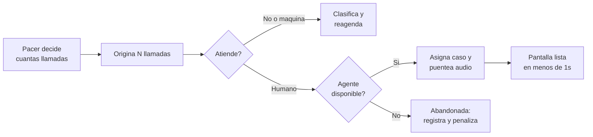
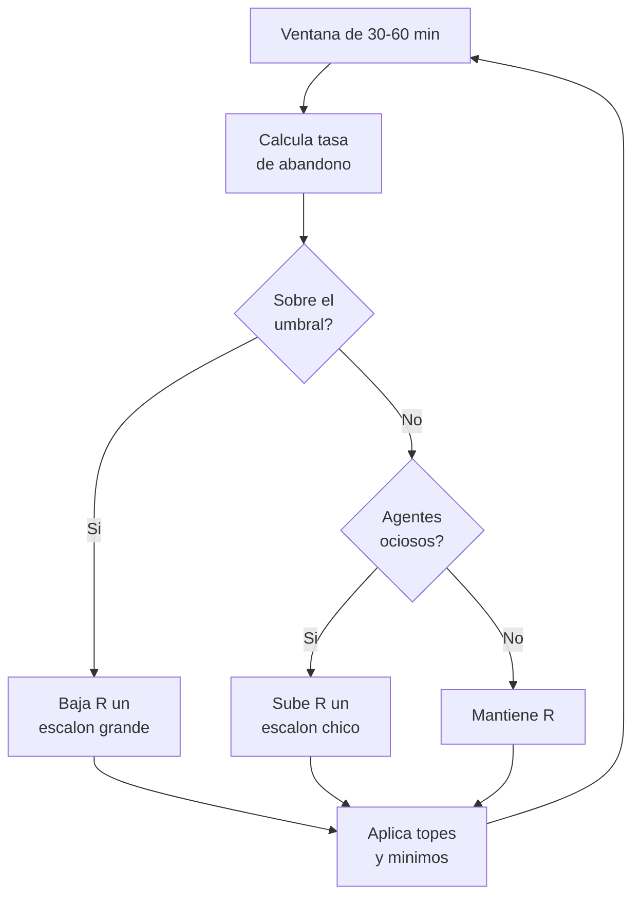

# INVOKE 2.0 — PRD por fases y decisiones de arquitectura

Sep 17, 2026 · @Equipos

## Contexto y problema

Equipos opera hoy su campo telefónico sobre una solución de terceros que no satisface por dos motivos concretos: **costo de licenciamiento** para 20 puestos simultáneos (con picos de 30) y **errores de código en los reportes**. Este proyecto construye el reemplazo.

El antecedente propio es INVOKE, el CATI que Equipos desarrolló alrededor de 2010 y que está fuera de servicio. Su código no se reutiliza, pero su modelo de dominio es la mejor especificación disponible de cómo trabaja la casa.

### Inventario del legacy (repositorio `invoke-legacy`)

| Módulo | Función | Tecnología | LOC aprox. |
| --- | --- | --- | --- |
| `invoke-lib` | Entidades de dominio y DTOs | Hibernate 3.0/3.1 con `.hbm.xml` | 8.000 |
| `invoke-agentmanager` | Servidor: sesiones, scheduler, Asterisk | Spring 1.2.6 MVC, asterisk-java sobre AMI | 16.700 |
| `invoke-cati` | Puesto del encuestador | Eclipse RCP / SWT | 25.700 |
| `invoke-manager` | Back-office, reportes, exportación | Struts 1.2.4, 89 JSP, JasperReports | 31.300 |
| `invoke-questionnaire` | Compilador del lenguaje PYR | JavaCC + JTB | 5.400 |

Java 1.5, build con Ant, MySQL con 39 tablas, 29 tests JUnit 3 sobre 1.132 fuentes. Passwords en texto plano y credenciales embebidas en el código.

### Qué se conserva y qué se descarta

Se conserva la **lógica de negocio**, no el código: el catálogo de disposiciones con su campo de comportamiento, los parámetros de reintento por disposición (ocupado 30 min, no contesta 120 min, fuera de servicio 180 min), el motor de cuotas por pregunta, área y phonebook, los grupos de sustitutos, y la cascada de prioridades del asignador de casos.

Se descarta el lenguaje PYR. Los cuestionarios históricos ya están almacenados en otra forma y su revisión queda a cargo de una persona, por lo que no se construye conversor.

### Restricciones de partida

- La sala es **100% remota**: todos los encuestadores trabajan desde sus casas.
- El trunk SIP ya está operativo y con buen desempeño. No se reevalúa.
- 20 puestos simultáneos, con picos de 30.
- Proyecto en paralelo, sin plazo externo impuesto.

## Objetivos, no-objetivos y métricas

El objetivo es una plataforma CATI propia, operable íntegramente desde el navegador por encuestadores remotos, con reportes auditables y modo de discado configurable por estudio.

### Objetivos

1. **Eliminar el costo de licencia por puesto.** El caso de negocio se cierra contra el gasto actual de 20 a 30 asientos.
2. **Reportes correctos y auditables.** Todo indicador se deriva de hechos registrados, no de contadores mutables.
3. **Cero instalación en el puesto.** El encuestador entra a una URL, con audio en el mismo navegador.
4. **Modo de discado elegible por estudio** desde la administración: preview, power y predictivo.
5. **Extensibilidad.** Agregar después nuevos tipos de participante — entre ellos agentes de IA — sin rehacer el núcleo.

### No-objetivos

- No se migra ni se mantiene el código de INVOKE legacy.
- No se construye conversor de PYR.
- No se reevalúa el proveedor de trunk SIP.
- No se soporta puesto presencial en sala con teléfono físico.

### Métricas de éxito

| Métrica | Cómo se mide | Meta |
| --- | --- | --- |
| Costo por encuesta completa | Costo total de operación / completas | Por debajo del costo actual con licencia |
| Encuestas completas por hora-encuestador | Completas / horas de sesión | Mejora sostenida al activar power y predictivo |
| Tiempo ocioso del encuestador | Horas disponible sin llamada / horas de sesión | Reducción frente a la línea base en preview |
| Tasa de abandono | Abandonadas / (abandonadas + conectadas a humano) | Por debajo del umbral configurado por estudio |
| Discrepancias de reporte | Reportes cuestionados por investigación por mes | Cero tras la Fase 0 |
| Calidad de audio percibida | Encuesta breve al encuestador por turno | Sin degradación frente a la solución actual |

La línea base de las cuatro primeras métricas debe medirse **sobre la solución actual antes de cortar**, o no habrá con qué comparar.

## Usuarios y escenarios

Son cuatro roles, y el que manda en el diseño es el encuestador remoto: todo lo demás existe para que él tenga una llamada válida enfrente.

| Rol | Dónde trabaja | Qué necesita del sistema |
| --- | --- | --- |
| Encuestador | Su casa, navegador, auricular USB | Recibir el caso y el audio juntos, aplicar el cuestionario, clasificar y reagendar |
| Supervisor de campo | Remoto | Ver quién está conectado y en qué estado, escuchar llamadas, intervenir |
| Administrador de estudio | Oficina o remoto | Cargar muestra, definir cuotas, elegir modo de discado y sus parámetros |
| Investigador | Oficina o remoto | Diseñar el cuestionario, seguir avance de cuotas, exportar datos |

### Escenario crítico: el traspaso de llamada al encuestador

En preview el encuestador pide el caso y después se disca. En power y predictivo el orden se invierte: se disca primero y el caso se asigna cuando alguien atiende. Esa inversión es la exigencia más dura de todo el sistema.

El camino `F` tiene un presupuesto duro: desde que el respondente dice "hola" hasta que el encuestador ve la ficha del contacto y la primera pantalla del cuestionario debe pasar menos de un segundo. Si no se cumple, el encuestador improvisa y la entrevista arranca mal.

El camino `G` es el que hay que minimizar, porque quema un caso de la muestra de forma irreversible.

### Consecuencias de que la sala sea 100% remota

- El audio viaja por la conexión domiciliaria del encuestador. Hace falta servidor TURN y monitoreo de calidad por puesto.
- No hay supervisor caminando la sala: **la consola de supervisión en vivo deja de ser un lujo y pasa a ser el único mecanismo de control**.
- El alta de un encuestador nuevo no puede requerir visita técnica: usuario, URL, auricular y prueba de audio automatizada.

## Decisiones de arquitectura

Siete decisiones tomadas en el análisis. Cada una vale hasta que aparezca evidencia que la contradiga; si cambia, se registra acá con su motivo.

### ADR-001 — Postgres es la fuente de verdad; Firebase no

Todo lo que afecta muestra, cuotas, respuestas o reportes vive en Cloud SQL Postgres. Firebase queda para autenticación y para el tablero de presencia en vivo.

El motivo es que el dominio exige asignación exclusiva de casos entre encuestadores concurrentes y conteos de cuota consistentes en tiempo real. La asignación se resuelve con `SELECT ... FOR UPDATE SKIP LOCKED`, que es exactamente lo que el `FIFOScheduler` del legacy emulaba a mano con caché y RMI.

**Excepción registrada:** el estado del encuestador (disponible / ocupado / en llamada) parece efímero pero alimenta el lazo del discador. Su fuente de verdad va en Postgres o Redis, y se espeja a Firebase solo para pintar el tablero.

### ADR-002 — Log de eventos inmutable, sin contadores mutables

Cada transición de estado de una llamada se escribe como evento inmutable con timestamp: originada, timbrando, atendida, clasificada como máquina, conectada a encuestador, encuesta iniciada, disposición final, reagendada. Ningún reporte lee contadores; todos son consultas sobre hechos, con vistas materializadas para velocidad.

Esta es la respuesta directa al problema de reportes. El legacy ilustra la patología: `Study.surveyCount` y `Study.completedCount` son contadores mutables, y todo contador mutable termina desincronizado del hecho que resume.

### ADR-003 — Asterisk moderno con ARI, no AMI

Asterisk 20 o superior con `chan_pjsip`, transporte WSS hacia el navegador y el trunk SIP existente hacia la PSTN. El control se hace por **ARI** — REST más WebSocket de eventos — y no por AMI.

El `CallManagerImpl` del legacy son 956 líneas de máquina de estados que escucha un flujo de eventos AMI y correlaciona a mano por `actionId` y `uniqueId`. ARI trata la llamada como un recurso y elimina esa capa entera.

**Regla de acoplamiento:** el estado de la llamada se persiste en Postgres desde los eventos de Asterisk. La aplicación nunca consulta a Asterisk para saber en qué estado está una llamada. Solo así un segundo nodo es una decisión de operaciones y no una reescritura.

### ADR-004 — SIP.js con interfaz propia, no un softphone empaquetado

El audio usa SIP sobre WebSocket con SRTP/DTLS, con **SIP.js** como librería. La interfaz es propia: el control de llamada va embebido en la pantalla del cuestionario.

Se descarta montar un softphone completo tipo Browser-Phone. El encuestador no debe ver un teclado numérico al lado del cuestionario; si lo ve, se pierde la mitad de la ganancia de usabilidad.

**Codec:** se negocia G.711 (PCMA) extremo a extremo siempre que sea viable, para que Asterisk solo puentee y no transcodifique. Como toda la sala es remota, hay que medir si G.711 aguanta las conexiones domiciliarias reales; si no, se pasa a Opus y se asume el costo de CPU de transcodificación. **Esta decisión queda abierta hasta la prueba de campo.**

### ADR-005 — TURN propio desde el día uno

Con sala 100% remota, el relay no es un caso de borde: es el camino normal para cualquier encuestador detrás de NAT simétrico. Se despliega coturn con capacidad dimensionada para 30 sesiones concurrentes y monitoreo de cuántas llamadas terminan usando relay.

### ADR-006 — Cuestionario como JSON con esquema, editado gráficamente

La definición del cuestionario es un documento JSON validado contra JSON Schema, que es a la vez fuente de verdad y formato de ejecución. Se construye un editor gráfico web que lo produce y lo consume.

El esquema debe cubrir lo que el DTD del legacy ya cubría, porque es el piso funcional conocido: opciones simples y múltiples, grillas, cajas de texto y código, fórmulas, validaciones por tipo, saltos condicionales, randomización de bloques, de opciones y de filas de grilla, y sustitución de texto desde la ficha del contacto.

No se construye conversor desde PYR.

### ADR-007 — El participante de la llamada es una abstracción

El núcleo no modela "encuestador humano en un navegador". Modela un **participante** que recibe un caso, recorre el cuestionario y emite respuestas y una disposición. El encuestador con WebRTC es la primera implementación.

Esto es lo que permite agregar después un agente de IA sin tocar el núcleo: sería otro participante, que en vez de renderizar pantallas consume el mismo JSON de cuestionario y escribe en las mismas tablas de respuestas. Si esta abstracción no existe desde el principio, agregarla después es reescribir el asignador, el pacer y el motor de cuestionario a la vez.

El costo hoy es bajo: es una frontera de interfaces, no código de más.

## Fase 0 — Diccionario de disposiciones y fórmulas

Esta fase no tiene código y es la que ataca la causa raíz del problema declarado. Produce un documento acordado entre sistemas e investigación que define cada código de disposición y cada fórmula de reporte. Todo lo que se construya después se valida contra él.

Los errores reportados hoy son bugs de código, no desacuerdos de definición. Aun así la Fase 0 se mantiene: sin definiciones escritas no hay forma de demostrar que el sistema nuevo calcula bien, y se repite el problema con otro código.

### Entregables

1. **Catálogo de disposiciones de teléfono y de encuesta**, cada una con código, nombre, comportamiento (continúa, termina, termina y explica, termina y agenda), si es final o reintentable, y el tiempo de espera antes del próximo intento.
2. **Nuevos códigos que el legacy no tenía**, entre ellos el de **llamada abandonada** — el respondente atendió y no había encuestador — que hoy no existe en el modelo y es imprescindible para operar power y predictivo.
3. **Fórmulas de reporte escritas**, con numerador y denominador explícitos: tasa de respuesta, tasa de cooperación, tasa de contacto, tasa de rechazo, tasa de abandono.
4. **Mapeo a las definiciones estándar de AAPOR**, para que los reportes a clientes sean defendibles metodológicamente y comparables con otros proveedores.
5. **Línea base medida sobre la solución actual** de las métricas de la sección anterior.

### Punto de decisión que hay que resolver acá

La pregunta que rompe casi todos los reportes CATI: **qué casos entran en el denominador de la tasa de respuesta.** Un número fuera de servicio, un fax, un no-elegible por cuota y un no-contacto tras diez intentos se tratan distinto según la definición elegida, y esa elección cambia el número que ve el cliente.

Hay que decidirlo una vez, escribirlo, versionarlo, y que el sistema lo implemente tal cual.

### Criterio de salida

Investigación y sistemas firman el documento, y existen los números de línea base. Sin eso no arranca la Fase 1.

## Fase 1 — Núcleo operativo

Objetivo: correr **un estudio real completo**, de punta a punta, con encuestadores remotos en el navegador y discado preview. Sin power, sin predictivo, sin supervisión en vivo.

El estudio elegido debe ser chico, de un cliente real y con fecha de entrega. Es la función forzante que reemplaza al plazo externo que este proyecto no tiene.

### Alcance

| Componente | Qué incluye |
| --- | --- |
| Telefonía | Asterisk con ARI y WSS, trunk SIP existente, coturn, grabación con muestreo por estudio |
| Puesto del encuestador | SIP.js embebido, control de llamada en la pantalla del cuestionario, prueba de audio previa al turno |
| Motor de cuestionario | Ejecución del JSON: tipos de pregunta, validaciones, saltos, randomización, piping desde la ficha |
| Editor de cuestionario | Editor gráfico web que produce y consume el JSON |
| Muestra | Carga de phonebook con propiedades, asignación con bloqueo, reintentos por disposición, reagendamiento |
| Cuotas | Evaluación en tiempo real por pregunta, área y phonebook, con corte por fuera de cuota |
| Registro | Log de eventos inmutable segun ADR-002 |
| Reportes | El subconjunto que el estudio piloto necesita, derivado del diccionario de Fase 0 |
| Exportación | Datos de respuestas en formato utilizable por investigación |

### Fuera de alcance en esta fase

Power y predictivo, consola de supervisión en vivo, escucha de llamadas, modo web autoadministrado, campañas de email, y la biblioteca completa de reportes del legacy.

### Riesgos propios de la fase

El riesgo dominante es el audio en conexiones domiciliarias, no el software. Antes de comprometer el estudio piloto hay que correr una prueba con tres o cuatro encuestadores reales durante una semana, midiendo pérdida de paquetes, jitter y proporción de llamadas que terminan pasando por TURN. Esa prueba también resuelve la decisión de codec que ADR-004 dejó abierta.

El segundo riesgo es de alcance: la tentación de portar los trece reportes del legacy antes de que corra la primera entrevista. Se construye solo lo que el piloto usa.

### Criterio de salida

El estudio piloto se entregó al cliente, con sus datos exportados y sus reportes coincidiendo con lo que investigación espera.

## Fase 2 — Power dialer y supervisión en vivo

Dos entregas que van juntas porque la segunda es el control de calidad de la primera: sin ver la sala en vivo no se puede operar un discador que sobre-disca.

### Power dialer

Por cada encuestador que queda disponible se originan **N** llamadas. El administrador elige el modo por estudio, y el sistema expone estos parámetros:

| Parámetro | Qué controla |
| --- | --- |
| Modo | Preview, power o predictivo |
| N inicial | Llamadas por encuestador disponible al arrancar |
| N máximo | Techo duro, no superable por el ajuste automático |
| Abandono objetivo | Umbral de tasa de abandono tolerada |
| Ajuste automático | Si N se recalcula solo o queda fijo en el valor inicial |

N no debería quedar fijo. El valor correcto se deriva de la **tasa de contacto observada del estudio en esa franja horaria**, que el log de eventos ya permite calcular. Ese cálculo es el mismo insumo que después usa el predictivo, por eso conviene construirlo en esta fase.

La inversión del orden descrita en la sección de escenarios — discar primero, asignar cuando alguien atiende — se implementa acá. Es el cambio estructural más profundo del proyecto y por eso va antes que el predictivo, que solo agrega el lazo de control encima.

### Consola de supervisión en vivo

Con sala 100% remota esta consola no es un extra: es el único mecanismo de supervisión que existe. Debe mostrar por encuestador el estado actual, el caso en curso, el tiempo en ese estado, y la **calidad de red del puesto** — pérdida de paquetes, jitter, si la llamada va por TURN.

La calidad de red por puesto es requisito y no adorno: el supervisor no puede acercarse a preguntar por qué se escucha mal.

Incluye escucha de llamadas en curso y la capacidad de intervenir. La grabación con muestreo por estudio, ya presente desde la Fase 1, sostiene el control de calidad diferido.

### Criterio de salida

Un estudio corrió completo en modo power con la tasa de abandono por debajo del umbral configurado, y el supervisor pudo detectar y resolver al menos un problema de calidad desde la consola sin llamar por teléfono al encuestador.

## Fase 3 — Discado predictivo

El predictivo agrega un lazo de control sobre el power ya construido: en vez de un N fijo, el sistema ajusta el sobre-discado para mantener la tasa de abandono bajo el umbral configurado por estudio.

Con 20 puestos simultáneos el predictivo tiene masa estadística suficiente. Por debajo de unos 8 encuestadores disponibles en el mismo estudio la varianza vuelve al predictivo peor que el power, así que el sistema debe caer automáticamente a power cuando la sala baja de ese umbral.

### El lazo de control

Se mide sobre **ventana deslizante** de 30 a 60 minutos, nunca acumulado desde el inicio del estudio. El acumulado vuelve al controlador sordo: a media tarde ya tiene tanta inercia que no reacciona al cambio de franja horaria.

El ajuste es **asimétrico**: baja rápido, sube lento.

La asimetría es la propiedad de diseño central y responde a una diferencia real de costos: el abandono quema un caso de la muestra de forma irreversible, mientras que el tiempo ocioso es costo recuperable. Ante la duda, el sistema prefiere agentes esperando antes que números quemados.

### Barandas

- Tope máximo del ratio de sobre-discado, no superable por el ajuste automático.
- Mínimo de encuestadores disponibles para que el predictivo se active; por debajo, caída automática a power.
- El umbral de abandono es un parámetro del estudio, no una constante del sistema.

### Calibración del detector de contestador

Este es el riesgo escondido de la fase. Si el AMD clasifica a un humano como contestador, el sistema corta la llamada a una persona real: es un abandono disfrazado que **no aparece en las estadísticas de abandono**. El AMD de Asterisk es de calidad mediocre.

La grabación construida en la Fase 1 hace posible la calibración: se toma una muestra de llamadas clasificadas como máquina, una persona las escucha, y se mide la tasa de falsos positivos. Esa tasa se suma a la de abandono para conocer el daño real.

La calibración se repite periódicamente, no una sola vez.

### Criterio de salida

Un estudio corrió en predictivo con abandono medido — incluyendo falsos positivos de AMD — por debajo del umbral, y con mejora demostrable en encuestas completas por hora-encuestador frente a la línea base de la Fase 0.

## Fase 4 — Extensibilidad

Esta fase no tiene alcance cerrado: es la lista de cosas que el sistema debe **poder** recibir, y la condición que las hace baratas.

La condición es ADR-007. Si el núcleo modela un participante genérico en vez de un encuestador humano con navegador, cada una de estas incorporaciones es un nuevo tipo de participante o un nuevo canal, no una reescritura.

### Agentes de IA como participante

Un agente de IA sería otra implementación de participante: recibe el caso asignado, consume el mismo JSON de cuestionario, y escribe respuestas y disposición en las mismas tablas. Lo que cambia es que en vez de renderizar pantallas mantiene una conversación por voz.

Lo que hay que resolver en su momento, y conviene tener presente desde ahora:

- **Transparencia.** El respondente tiene que saber que habla con un sistema. No es opcional ni negociable, y además condiciona el diseño del speech de presentación.
- **Comparabilidad.** Si en un tracking una ola se levanta con humanos y la siguiente con IA, el efecto del entrevistador cambia y los datos dejan de ser comparables. Es una decisión metodológica de investigación, no de sistemas.
- **Reparto de la muestra.** El asignador debe poder dirigir casos a un tipo de participante u otro por estudio, por estrato o por porcentaje, para poder validar con diseño experimental.
- **Media.** El audio del agente de IA no pasa por un navegador; entra al puente de Asterisk por otro camino. ARI ya lo permite.

### Otros canales del mismo modelo

| Extensión | Qué reutiliza |
| --- | --- |
| Encuesta web autoadministrada | El mismo JSON de cuestionario, sin participante entrevistador |
| Envío de invitaciones y recordatorios | La muestra y las disposiciones, con un canal adicional |
| Modo presencial o mixto | Los estados extendidos que el legacy ya tenía para campo |
| Segundo nodo Asterisk | Posible sin tocar la aplicación, por la regla de acoplamiento de ADR-003 |

### Lo que esta fase exige de las anteriores

Nada de esto se construye ahora. Lo único que se hace desde la Fase 1 es **no cerrar la puerta**: la frontera de participante definida, el cuestionario ejecutable sin interfaz, y el asignador capaz de discriminar por tipo de destinatario.

Es una decisión de interfaces, no código de más.

## Riesgos y supuestos abiertos

El riesgo dominante no es técnico: es que un proyecto en paralelo sin plazo externo nunca termine.

| Riesgo | Impacto | Cómo se valida o mitiga |
| --- | --- | --- |
| El proyecto se muere por inanición cerca del mes 4 | Alto | Comprometer un estudio real con fecha de cliente como criterio de salida de Fase 1 |
| El audio no aguanta en conexiones domiciliarias | Alto | Prueba de una semana con 3 o 4 encuestadores antes de comprometer el piloto |
| El AMD clasifica humanos como máquina | Alto | Escucha de muestra grabada, medición periódica de falsos positivos |
| Se porta la biblioteca completa de reportes antes de la primera entrevista | Medio | Construir solo lo que el piloto usa |
| Un solo Asterisk deja a 30 personas sin trabajar | Medio | Estado en Postgres desde Fase 1; nodo en espera cuando el volumen lo justifique |
| La inversión del orden de discado se deja para después | Alto | Se implementa en Fase 2, antes del lazo de control |

### Supuestos que hay que confirmar

1. **La fecha de renovación de la licencia actual.** Es el único plazo real disponible y convierte el caso de negocio en un número. Si existe, es la función forzante del proyecto.
2. **El costo anual de licencia para 20 a 30 puestos.** Sin ese número no hay caso de negocio que presentar.
3. **La calidad de las conexiones domiciliarias reales** de los encuestadores actuales, que decide el codec de ADR-004.
4. **Qué reportes puntuales fallan hoy y cómo.** Aunque el diagnóstico sea de bugs, la lista concreta es el insumo del catálogo de Fase 0.
5. **Si algún estudio en curso es de seguimiento**, porque eso condiciona cuánto importa la comparabilidad entre olas y limita cuándo puede entrar un agente de IA.

### Próximo paso

Conseguir los puntos 1 y 2. Con esos dos números el proyecto deja de ser paralelo y pasa a tener presupuesto, prioridad y fecha.
