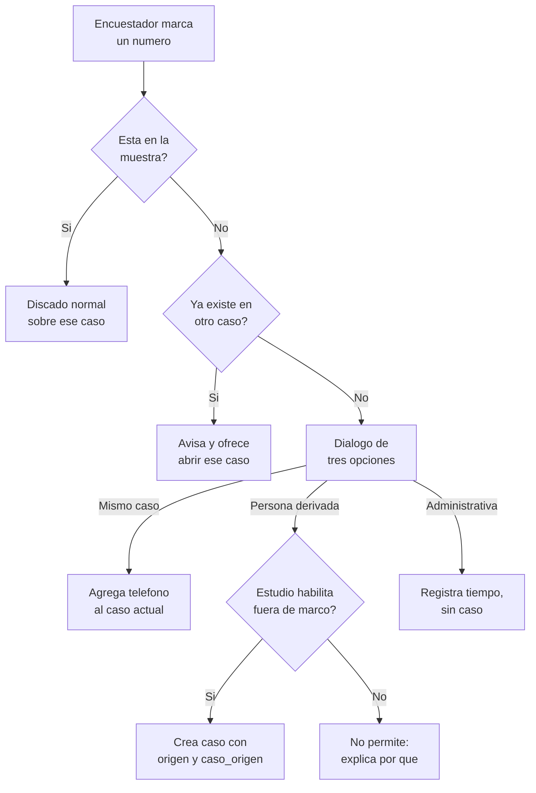

# Política de casos fuera de marco — INVOKE 2

Nov 18, 2026 · @Equipos

## Propósito

Este documento define qué pasa cuando un encuestador marca, en modo manual, un número que no está en la muestra.

Es la bajada operativa de ADR-008 del PRD. Existe como documento aparte porque toca dos mundos a la vez: la interfaz del encuestador y el cálculo de las tasas.

### El problema

INVOKE 2 admite discado manual por estudio: hay operativos que se levantan marcando a mano — muestras chicas, contactos institucionales, re-contactos, seguimiento de casos especiales. En esos operativos aparece inevitablemente la situación de llamar a un número que no estaba en la muestra: alguien te deriva a un colega, el titular te pasa su celular, un contacto te da el teléfono de la persona que sí responde.

Si esas llamadas no tienen dónde caer en el modelo, pasa una de dos cosas, y las dos son malas:

- Quedan como llamadas sin caso, invisibles en los reportes. Ese es el agujero que después aparece como un número que no cierra.
- Se mezclan silenciosamente con la muestra, y la tasa de respuesta y las ponderaciones quedan mal calculadas.

El legacy tenía la primera versión del problema: su modo manual forzaba la disposición a "Contesta" porque el sistema no veía la llamada.

### La regla central

> **Toda llamada pertenece a un caso, y todo caso declara su origen.**

No hay llamadas huérfanas. Antes de que la llamada arranque, el número desconocido se clasifica, y esa clasificación determina si el caso entra o no al denominador del marco.

### Por qué un derivado no entra al denominador

Un número que no estaba en el marco **no tenía probabilidad conocida de selección**. Mezclarlo con la muestra original rompe dos cosas: la tasa de respuesta, porque cambia el denominador con casos que nunca fueron seleccionados, y las ponderaciones, porque el peso de esa unidad es indeterminado.

Eso no quiere decir que la entrevista no sirva. Quiere decir que se cuenta aparte y se declara.

Si un estudio terminó con 12% de completas de origen derivado, eso tiene que estar a la vista del cliente, no disuelto en el total.

## Los tres tipos

Un número desconocido marcado a mano es una de tres cosas. Son metodológicamente distintas y mezclarlas es lo que rompe los reportes.

| Tipo | Ejemplo típico | Qué hace el sistema | Efecto en las tasas |
| --- | --- | --- | --- |
| **Otro teléfono del mismo caso** | "El titular no está, llamalo al celular" | Agrega el número al caso existente | Ninguno |
| **Persona nueva derivada** | "Hablá con mi colega, este es su interno" | Crea un caso nuevo con origen declarado | Fuera del denominador del marco |
| **Llamada administrativa** | Verificar una entrevista ya hecha | Registra tiempo, sin caso de encuesta | Ninguno; tampoco cuenta como intento |

### 1. Otro teléfono del mismo caso

La unidad muestral es la misma persona; cambia el número. El caso no se duplica: se le agrega un teléfono.

La estructura ya existe desde el legacy, que separaba el teléfono del caso. Lo único que hay que registrar además es **cuál de los números produjo el contacto final**, que después sirve para analizar por qué canal se llega mejor a cada estrato.

Es el tipo más frecuente y el más inofensivo.

### 2. Persona nueva derivada

Es una unidad muestral nueva que no estaba en el marco. Entra al sistema como caso, pero con dos campos que la marcan:

- `origen`, con valor `derivado`, `reemplazo_manual` o `lista_externa`
- `caso_origen`, apuntando al caso desde el cual surgió

Ese segundo campo arma la **cadena de derivados**, que en estudios de poblaciones difíciles de alcanzar — empresas, profesionales, directivos — es un dato valioso en sí mismo y hoy se pierde.

### 3. Llamada administrativa

No es un intento de entrevista: coordinación, concertación de cita, verificación de una entrevista ya hecha, supervisión.

No produce disposición de encuesta y **no cuenta como intento de contacto**. Queda solo en el log de tiempos, para el cálculo de productividad del encuestador.

Hoy estas llamadas se cuelan como intentos y ensucian la contactabilidad: aparecen como llamadas que "contestaron" y que no produjeron encuesta.

### El caso límite

Un derivado que resulta ser **la misma persona que ya estaba en la muestra con otro número** es el tipo 1, no el tipo 2. El sistema debería detectarlo verificando el número contra la muestra antes de ofrecer la clasificación, y resolverlo solo cuando el número ya existe en otro caso del mismo estudio.

Sin esa verificación se generan casos duplicados que inflan el denominador.

## Modelo de datos y flujo

### Campos nuevos en el caso

| Campo | Valores | Obligatorio |
| --- | --- | --- |
| `origen` | `marco`, `derivado`, `reemplazo_manual`, `lista_externa` | Sí, con `marco` por defecto |
| `caso_origen` | Identificador de otro caso del mismo estudio | Solo si `origen` no es `marco` |
| `usuario_creador` | Quién creó el caso | Solo si `origen` no es `marco` |
| `motivo` | Texto libre breve | Solo si `origen` no es `marco` |

Un caso cargado desde la muestra tiene `origen = marco` y los otros tres vacíos. Nada cambia para el flujo normal.

### El flujo de clasificación

### Reglas del diálogo

**Aparece antes de que la llamada arranque, no después.** Es el único momento en que el encuestador sabe la respuesta: reconstruirlo más tarde desde el CDR es imposible.

**No se puede saltear.** No hay opción "después lo clasifico". Son tres segundos y resuelven el agujero de reporte de forma definitiva.

**La opción 1 requiere un caso abierto.** Si el encuestador no tiene ningún caso en pantalla, "otro teléfono del mismo caso" no se ofrece: no hay caso al cual agregarlo.

**La opción 2 puede estar deshabilitada por estudio**, y en ese caso se muestra con el motivo, no se oculta. Un encuestador que no entiende por qué no puede cargar un derivado termina clasificándolo mal con tal de poder llamar.

### Lo que INVOKE 2 gana sobre el legacy

En modo manual el audio igual pasa por WebRTC y Asterisk. Eso significa que **el sistema ve la llamada**: la disposición de teléfono se detecta igual que en los modos automáticos, la llamada se graba segun el muestreo del estudio, y el tiempo queda cronometrado.

El legacy no podía hacer nada de eso: su modo manual forzaba la disposición porque el encuestador marcaba en un aparato que el sistema no veía.

El discado manual deja de ser un hueco en las estadísticas.

## Efecto en reportes

### Tasas

| Tasa | Casos fuera de marco |
| --- | --- |
| Tasa de respuesta | Excluidos del numerador y del denominador |
| Tasa de cooperación | Excluidos |
| Tasa de contacto | Excluidos |
| Completas entregadas al cliente | **Incluidas**, declaradas aparte |

La última fila es la que suele sorprender: una entrevista derivada **sí es una entrevista válida** y se entrega. Lo que no hace es participar del cálculo de tasas del marco.

### Lo que el informe debe declarar

Siempre que un estudio tenga casos fuera de marco:

- Cuántas completas son de origen fuera de marco, en absoluto y en porcentaje del total entregado
- Desglose por valor de `origen`
- Las tasas del marco, calculadas sin ellos

Esto no es letra chica. Si un estudio entrega 400 completas de las cuales 48 son derivadas, el cliente tiene que saberlo antes de usar esos datos para inferir sobre la población.

### Cuotas

**Resuelto: sí cuentan para la cuota.** La cuota describe la composición de la población lograda, y una entrevista derivada aporta a esa composición igual que cualquier otra.

El argumento a favor de que cuenten: la cuota describe la composición de la población lograda, y una entrevista derivada aporta a esa composición igual que cualquier otra.

El argumento en contra: si los derivados cuentan para cuota, un estrato difícil puede completarse casi enteramente con derivados, y la cuota deja de representar lo que decía representar. El efecto es silencioso y solo se nota al analizar.

Queda la salvaguarda: el sistema **alerta cuando un estrato supera un umbral de composición derivada**, y ese umbral es una **propiedad del estudio**, no una constante del sistema. Si un estrato difícil se completa casi enteramente con derivados, la cuota deja de representar lo que decía representar, y el efecto es silencioso hasta que alguien analiza los datos.

Se decide con investigación, no por defecto técnico.

### Ponderación

Un caso fuera de marco no tiene peso de diseño calculable, porque no tenía probabilidad de selección. **Por eso queda excluido del análisis ponderado.**

Es el criterio conservador: la entrevista se entrega y se cuenta entre las completas, pero no participa de ninguna estimación ponderada sobre la población. Asignarle el peso medio de su estrato habría sido más cómodo, pero equivale a fingir que el caso tenía una probabilidad de selección que nunca tuvo.

Para que esa exclusión sea posible, **el sistema tiene que entregar el caso marcado**. Si llega mezclado con los del marco, ya no hay manera de separarlo al analizar.

## Habilitación y controles

### Por estudio, no global

Crear casos fuera de marco es una capacidad que se prende o apaga desde la administración del estudio.

| Tipo de estudio | Fuera de marco | Por qué |
| --- | --- | --- |
| Muestra probabilística de población general | Apagado | Cualquier agregado rompe el diseño |
| Base de clientes entregada por el cliente | Apagado por defecto | El marco es cerrado y definido por el cliente |
| Estudio a empresas o instituciones | Prendido | La derivación interna es parte del trabajo |
| Población difícil de alcanzar | Prendido | El referido puede ser el único camino |

El valor por defecto es **apagado**. Un estudio que lo necesita lo pide explícitamente.

### Controles

La capacidad de crear casos nuevos desde el puesto del encuestador es, sin controles, una vía para inflar producción. Tres medidas razonables:

1. **Todo caso fuera de marco queda atribuido** a quién lo creó, cuándo y desde qué caso origen.
2. **El tablero de supervisión muestra** cuántos creó cada encuestador, y lo marca cuando se desvía del resto de la sala.
3. **Las completas de origen fuera de marco entran con prioridad al muestreo de grabación** para control de calidad.

Ninguna de las tres supone mala fe. Son las mismas que cualquier operación aplica sobre un procedimiento que crea unidades de producción.

### Límite por guía

El tope de casos fuera de marco es **propiedad de la guía**, no del estudio: un estudio puede cargar varias guías y cada una se extiende hasta donde su propio diseño lo admita. Si los casos fuera de marco superan el porcentaje configurado para esa guía, el sistema deja de permitir la creación y avisa al coordinador. Un valor vacío significa sin tope.

Una guía donde el 40% de los casos son derivados ya no es la guía que se diseñó. Mejor que el sistema lo frene a que se descubra al analizar.

Ojo con la asimetría, que es deliberada: el **umbral de alerta** de la decisión 2 es del estudio, porque las cuotas son del estudio; el **tope** de acá es de la guía, porque mide cuánto se estiró esa base de muestra en particular.

### Decisiones abiertas

| # | Decisión | Opciones |
| --- | --- | --- |
| 1 | ¿Los casos fuera de marco cuentan para cuota? | Resuelto: sí cuentan |
| 2 | Umbral de alerta de composición derivada por estrato | Porcentaje configurable como propiedad del estudio |
| 3 | Tope de casos fuera de marco por estudio | Resuelto: propiedad de la guía; porcentaje configurable, o sin tope |
| 4 | Tratamiento de `lista_externa` | Resuelto: fuera de marco (es un agregado, no parte del diseño) |
| 5 | ¿Un derivado hereda estrato y cuotas del caso origen? | Sí, hereda estrato y cuotas del caso origen |
| 6 | Ponderación por defecto | Resuelto: excluido del análisis ponderado |

Las decisiones 1, 2 y 4 son las mismas que figuran en el diccionario de disposiciones y en el documento de fórmulas. Se resuelven una sola vez, en la reunión con investigación, y se replican.

Sobre la 5, ya resuelta: el derivado **hereda estrato y cuotas del caso origen**. Es lo correcto en el caso típico, que es la derivación dentro de una misma empresa o institución.

Pero conviene que la herencia sea un **valor inicial editable, no fijo**: un referido personal no necesariamente comparte estrato con quien lo derivó, y si el encuestador no puede corregirlo, ese caso entra mal clasificado y contamina la cuota del estrato equivocado.
