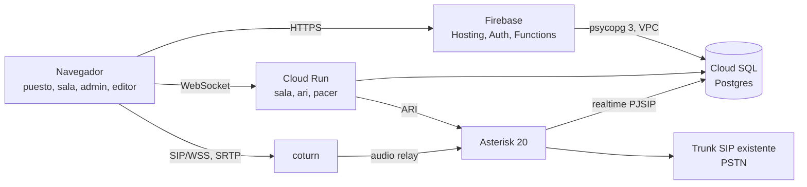

# Registro de decisiones — INVOKE 2

Nov 19, 2026 · @Equipos

## Cómo leer este registro

Una decisión vale hasta que aparezca evidencia que la contradiga; si cambia, se registra acá con su motivo (PRD).

| Prefijo | Qué es |
| --- | --- |
| **ADR** | Decisiones de arquitectura: las 10 del PRD más ADR-011 y ADR-012, nacidas al implementar |
| **DI** | Decisiones de implementación: detalles que los documentos no fijaban y el código tuvo que resolver. Las marcadas *provisoria* esperan a investigación |
| **P** | Pendientes: lo que sigue abierto, quién lo resuelve y qué bloquea |

Las definiciones de disposiciones y fórmulas no están acá: viven en el `Diccionario de disposiciones` y en `Fórmulas de reporte y mapeo AAPOR`, que la implementación lee literalmente.

### Arquitectura

Postgres decide; Cloud Run reacciona. Ningún componente le pregunta a Asterisk ni a Firebase el estado de nada.

## Decisiones de arquitectura del PRD

### ADR-001 — Postgres es la fuente de verdad; Firebase no

**Estado:** implementada.

- **Decisión.** Muestra, cuotas, respuestas y reportes viven en Cloud SQL Postgres. Firebase autentica y, opcionalmente, pinta presencia.
- **Dónde.** `db/migrations/0003`–`0006`. La asignación usa `SELECT … FOR UPDATE SKIP LOCKED` en `invoke.asignar_caso`, más un índice único parcial sobre `caso_estado.asignado_a` (un participante, un caso). Los roles salen de `invoke.usuario`, no de custom claims.
- **Excepción.** El estado del encuestador vive en `invoke.participante_estado` y se espeja a Firestore `presencia/` solo con `INVOKE_ESPEJO_FIREBASE=1`.
- **Verificación.** `test_asignacion_concurrente_skip_locked`: dos conexiones reales compiten por un caso; una lo obtiene y la otra sigue sin esperar.

### ADR-002 — Log de eventos inmutable, sin contadores mutables

**Estado:** implementada.

- **Decisión.** Toda transición es una fila de `invoke.evento` (32 tipos). Ningún reporte lee contadores.
- **Dónde.** `0004_eventos.sql`. Un trigger rechaza UPDATE, DELETE y TRUNCATE aunque lo intente el dueño, y la aplicación solo tiene INSERT y SELECT. Respuestas y calidad de red son tablas de hechos con la misma protección. No existen `surveyCount` ni `completedCount`: el avance de cuotas y el "estudio completo" son vistas sobre completas.
- **Matiz.** El asignador necesita una proyección operativa, que no es un contador de reporte (ADR-012).
- **Verificación.** `test_evento_inmutable`, `test_accesos`.

### ADR-003 — Asterisk moderno con ARI, no AMI

**Estado:** implementada, sin probar contra un PBX real (P-01).

- **Decisión.** Asterisk 20+ con `chan_pjsip`, WSS hacia el navegador, trunk existente hacia la PSTN y control por ARI.
- **Dónde.** `infra/asterisk/` (AMI deshabilitado en `modules.conf`). `services/ari/traductor.py` convierte eventos ARI en hechos. Cada llamada se origina con `channelId = llamada_id`, así que no hay correlación manual por `actionId`/`uniqueId` (las 956 líneas del `CallManagerImpl` legacy).
- **Regla de acoplamiento.** La aplicación nunca consulta a Asterisk el estado de una llamada. Al reiniciar, `services/ari` reconstruye qué canal es de qué puesto leyendo la base.
- **Verificación.** `tests/test_ari.py` con un puerto doble: preview, no contesta, abandono, máquina y canal ajeno.

### ADR-004 — SIP.js con interfaz propia; teclado según el modo

**Estado:** implementada; el codec sigue abierto (P-02).

- **Decisión.** SIP.js embebido. El control de llamada va en la pantalla del cuestionario. El teclado es un panel que aparece solo en modo manual.
- **Dónde.** `web/js/telefono.js`; SIP.js 0.21.2 vendoreado como ESM en `web/vendor/sip.js`, sin build. En manual el sistema sí ve la llamada: pasa por Asterisk y su disposición se registra como en los otros modos, sin forzar "Contesta" como el `CatiControlManualMode` legacy.
- **Codec.** Se ofrece `alaw,ulaw,opus` al puesto y `alaw,ulaw` al trunk. Si la prueba de campo valida G.711, se saca opus del endpoint.

### ADR-005 — TURN propio desde el día uno

**Estado:** implementada.

- **Dónde.** `infra/coturn/turnserver.conf` con `use-auth-secret` y cuotas para 30 sesiones. Solo retransmite hacia el PBX: no es un proxy abierto. La API entrega credenciales efímeras (HMAC del secreto compartido) en `invoke/servicios/credenciales.py`.
- **Monitoreo.** El puesto reporta en cada muestra de `getStats()` si el candidato elegido es `relay`. La consola lo muestra como "TURN" y la proporción se consulta sobre `invoke.calidad_red`.

### ADR-006 — Cuestionario como JSON con esquema, editado gráficamente

**Estado:** implementada.

- **Dónde.** `schemas/cuestionario.schema.json` (JSON Schema 2020-12). Cubre el piso del DTD legacy: simple y múltiple (con "otro" y opción exclusiva), grilla, texto con patrón, número, código, fecha, hora, fórmula, validaciones por tipo y de pantalla, saltos por opción y por regla, fin con disposición, aleatorización de bloques, opciones y filas, y sustitución `{ficha.x}` / `{VAR}` / `{VAR.texto}`. Editor gráfico en `web/editor.html`, con vista previa que corre el motor real.
- **Versiones.** Una versión publicada no se modifica (trigger). Cada respuesta guarda el cuestionario con el que se registró.
- **Sin PYR.** No hay conversor. Los códigos 1998 y −1, reservados en el legacy, el esquema los rechaza.

### ADR-007 — El participante de la llamada es una abstracción

**Estado:** implementada como frontera.

- **Dónde.** Tabla `invoke.participante` con `tipo` (`encuestador_webrtc`, `agente_ia`). El asignador, el pacer y las proyecciones hablan de participante. El protocolo está en `invoke/dominio/participante.py`. El motor de cuestionario corre sin interfaz (`Motor.recorrer`): un agente de IA consumiría el mismo JSON.
- **Costo.** Una frontera de interfaces; el agente de IA no se construye (Fase 4).

### ADR-008 — Toda llamada pertenece a un caso, y el caso declara su origen

**Estado:** implementada.

- **Dónde.** `invoke.caso.origen` (`marco`, `derivado`, `reemplazo_manual`, `lista_externa`), `caso_origen`, `usuario_creador` y `motivo`, con CHECKs que exigen los campos según el origen. `invoke.clasificar_numero` detecta el caso límite (el "derivado" ya estaba en la muestra). `invoke.crear_caso_fuera_de_marco` exige el flag del estudio y el tope de la guía, y hereda estrato y propiedades como valor inicial editable. El diálogo de tres opciones aparece antes de discar y no se puede saltear.
- **No hay huérfanas.** Una disposición de teléfono sin caso se rechaza en la base, salvo en una llamada originada como administrativa, que no cuenta como intento.
- **Verificación.** `test_fuera_de_marco`, `test_tope_fuera_de_marco_por_guia`, `test_llamada_huerfana_rechazada`.

### ADR-009 — Vista de compatibilidad CDR, con fecha de caducidad

**Estado:** implementada; equivalencias pendientes (P-04).

- **Dónde.** `invoke.cdr_compat` (`0008_cdr_compat.sql`) y `GET /api/cdr`. Tiene campaña, agente, las dos disposiciones en un campo separado por `|`, intentos por franja, estrato, tipo de marcador y la marca `es_estudio` (en lugar de la lista de nombres en el script). El rol `invoke_lectura` es para el script del tablero.
- **Sin equivalente.** Los códigos 30, 31 y 32 salen como `SIN_EQUIVALENTE:<código>`, nunca forzados a otro valor. Mientras la columna de equivalencias del diccionario siga vacía, sale la etiqueta propia de INVOKE 2.
- **Retiro.** Escrito en la cabecera de la migración: la vista y el tablero viejo se retiran juntos el día que no quede ningún estudio en la solución anterior.

### ADR-010 — El stack es el de `paneles`, con una desviación acotada

**Estado:** implementada.

- **Dónde.** Python 3; Cloud Functions con único punto de entrada y ruteo propio (`functions/main.py` → `invoke/enrutador.py`); Cloud SQL con psycopg 3; migraciones SQL numeradas; Firebase Auth; HTML, CSS y JS plano sobre Hosting; pytest; región `southamerica-east1`. Tres procesos en Cloud Run (`services/ari`, `sala`, `pacer`), que son la única desviación.
- **Convenciones.** Las invariantes viven en la base, hay un `CLAUDE.md` con reglas duras y `scripts/verificar_accesos.py` falla si una migración abre un acceso de más. Tipos del frontend con JSDoc y `tsc --checkJs` en CI, sin `dist/`.
- **Aviso.** El repositorio `paneles` no estuvo accesible durante la implementación. El stack se siguió según su descripción en el PRD (P-09).

## Decisiones de arquitectura nuevas

### ADR-011 — Una pata de audio permanente por puesto

- **Decisión.** Al empezar el turno el navegador hace una sola llamada SIP a `sala-<participante>`, que entra a Stasis y queda en un puente mixto propio (`puesto-<id>`). Cada respondente se suma a ese puente desde ARI; colgar corta la pata del respondente, no la del puesto.
- **Por qué.** El camino H del PRD tiene un presupuesto de menos de 1 s desde el "hola" hasta la pantalla lista. Con la pata permanente el audio ya está negociado (ICE, DTLS, TURN) cuando alguien atiende, y el traspaso es agregar un canal a un puente. La ficha viaja en el mismo aviso de la sala. Además, los cuatro modos de discado usan el mismo mecanismo.
- **Seguridad.** El dialplan solo acepta `sala-N` si el endpoint autenticado es `pN`. La credencial SIP es efímera y en la base solo queda el hash md5.
- **Costo.** Un canal por puesto conectado (30 en pico). Si el puesto pierde la red, la pata se cae y el navegador reconecta solo.

### ADR-012 — Proyección operativa del caso, escrita solo por el trigger de eventos

- **Decisión.** `invoke.caso_estado` guarda lo que el asignador necesita leer rápido: estado, próximo intento, agenda, intentos por franja, sustituto activo y si hubo abandono. La escribe exclusivamente el trigger de `invoke.evento`, en la misma transacción y con `SECURITY DEFINER`; la aplicación no tiene privilegio de escritura sobre ella.
- **Por qué no contradice ADR-002.** No es un contador de reporte: ningún reporte la lee. Además es reconstruible: `invoke.reconstruir_caso_estado(caso)` la rehace reproduciendo los eventos, y `test_proyeccion_reconstruible` verifica que coincide con la incremental.
- **Cierres por tope.** Cuando la proyección cierra un caso por tope de intentos, de disposición o de franjas, emite el hecho `caso_cerrado`, así el cierre también queda en el log (DI-02).

## Decisiones de implementación

Lo que los documentos dejaron sin precisar y el código resolvió. Las provisorias se cambian por configuración o con una migración nueva, sin tocar lógica.

| # | Decisión | Dónde | Estado |
| --- | --- | --- | --- |
| DI-01 | Los reportes se calculan con un **instante de corte** (`p_hasta`): el mismo pedido da el mismo número aunque el estudio siga corriendo. Por defecto, el reloj del momento. | `invoke.clasificar_casos`, `conteo_tasas` | Tomada |
| DI-02 | El cierre por tope queda como evento `caso_cerrado`, para que el corte en el tiempo sepa cuándo un no-contacto pasó a definitivo. | `invoke.cerrar_caso` | Tomada |
| DI-03 | Casos sin resolver: en un reporte **parcial** quedan "en proceso" (EP) y fuera de las tasas. En el de **cierre**: nunca llamado o sin contacto → UD; agendada sin cierre o contactado sin disposición → NC; con abandono → AB. | `0007_reportes.sql` | Tomada |
| DI-04 | Un caso con un abandono (30) o un falso positivo de AMD (32) y sin disposición de encuesta posterior se clasifica AB. | `clasificar_casos` | Tomada |
| DI-05 | Abandonada: espera de 24 h, en franja rotada, tope 2. Nunca vuelve al pacer: el asignador la ofrece en **preview** aunque el estudio esté en power o predictivo (regla del diccionario). | `regla_reintento_defecto`, `asignar_caso` | Provisoria |
| DI-06 | Topes por defecto: 8 intentos por caso y 3 por franja; ninguna disposición tiene tope propio salvo la abandonada. Franjas por defecto de la línea base: mañana 09:00–16:30 y tarde 16:30–21:00 (hora de Montevideo). | `invoke.estudio`, trigger de defectos | Provisoria |
| DI-07 | La disposición 50 "No aplica" no está en los grupos del documento de fórmulas: provisoriamente es **NE**. | `disposicion_encuesta` | Provisoria |
| DI-08 | Estados extendidos 13–18: sin símbolo de cálculo. Las finales se reportan aparte como "SC", y Recall, Retomar y Corregir (15, 16, 18) reabren el caso. Solo los aplica un supervisor. | `disposicion_encuesta.efecto_caso` | Tomada |
| DI-09 | Cascada del asignador heredada del `FIFOScheduler`: agenda propia en ventana estrecha (±30 min) → agenda libre estrecha → agenda propia → agenda libre → pool común. El pool se ordena por prioridad de guía y luego por **orden aleatorio estable** asignado al cargar, en lugar del `rand()` por consulta del legacy. La agenda es una ventana única, no la ventana diaria repetida (ambigua en el legacy). | `invoke.asignar_caso` | Tomada |
| DI-10 | Cuotas: tres tipos como el legacy (pregunta, área, propiedad de la ficha), con objetivo absoluto o % del objetivo del estudio. Las de área y propiedad filtran la asignación. Las de pregunta se evalúan **en cada pantalla**, no como foto al cargar el caso. Una completa que excede la cuota por concurrencia se acepta: no se descarta una entrevista hecha. | `cuota_avance`, `evaluar_cuotas` | Tomada |
| DI-11 | Teléfonos normalizados al número nacional significativo uruguayo (sin 598 ni 0). Hace que la lista negra sea transversal de verdad: `099 123 456` y `+598 99 123 456` son el mismo número. | `invoke.normalizar_telefono` | Tomada |
| DI-12 | Credenciales SIP efímeras: se rotan en cada inicio de sesión y en la base solo queda `md5(usuario:realm:clave)`, sin el texto plano que tenía el legacy. TURN con credenciales REST de 12 h. | `credenciales.py`, `asterisk.ps_auths` | Tomada |
| DI-13 | El servidor no confía en el navegador: antes de aceptar una completa, recorre la entrevista entera con el motor Python. Si hay errores, o el flujo termina con otra disposición, la completa se rechaza. | `estacion._validar_completa` | Tomada |
| DI-14 | Aleatorización reproducible: la semilla es el id del caso (FNV-1a + mulberry32, idénticos en Python y JS). Retomar una entrevista muestra el mismo orden. | `cuestionario.py`, `motor.js` | Tomada |
| DI-15 | Comandos de telefonía por una cola en Postgres (`comando_telefonia`, LISTEN/NOTIFY + SKIP LOCKED) con un único consumidor ARI. La API y el pacer nunca hablan con Asterisk. | `services/ari/main.py` | Tomada |
| DI-16 | La sala se alimenta de `pg_notify` del trigger de eventos. Hay como mucho una foto por segundo por estudio para la consola, y la ficha del caso viaja dentro del aviso de conexión. | `services/sala/main.py` | Tomada |
| DI-17 | "Llamada descartada": el pacer corta llamadas que todavía timbran porque la sala se vació. No es intento ni abandono, y el caso vuelve tal cual. | `services/pacer`, trigger | Tomada |
| DI-18 | Power: N = 1 / tasa de contacto observada en la franja (últimos 14 días, mínimo 30 intentos; si no, N inicial), acotado por N máximo. Predictivo: baja R 25 % si el abandono real supera el objetivo y sube 0,05 si hay ocio de más de 15 s. Actúa solo con 20 o más conexiones en la ventana y registra como mucho un ajuste por minuto. | `invoke/dominio/pacer.py` | A calibrar |
| DI-19 | La tasa de contacto se implementó literal: Agendada y Fuera de Cuota entran como NC en el denominador pero no en el numerador, aunque hubo contacto. **A revisar con investigación**: probablemente deberían contarse como contacto. | `formulas.tasas_marco` | A revisar |
| DI-20 | Exportación: una variable 0/1 por opción en las múltiples y una por fila en las grillas. Cada registro lleva `origen` y `ponderable` (0 para fuera de marco), y el .sav lleva etiquetas de variable y de valor. | `exportacion.py` | Tomada |
| DI-21 | El supervisor escucha con `snoop` de ARI sobre la pata del encuestador (oye a las dos partes). Con "susurrar" le habla solo al encuestador. Para escuchar, conecta su propia pata de audio desde la consola. | `supervision.escuchar` | Tomada |
| DI-22 | La lista externa se carga como guía con `origen = lista_externa`: queda fuera del marco (decisión 8 del diccionario) y lleva quién la cargó. | `muestra.cargar_guia` | Tomada |
| DI-23 | Un estudio fija sus versiones de diccionario y fórmulas al activarse: un trigger impide cambiarlas después. | `tg_estudio_versiones_fijas` | Tomada |

## Pendientes

Ninguno bloquea arrancar la prueba de audio; algunos sí bloquean el piloto.

| # | Pendiente | Quién | Bloquea |
| --- | --- | --- | --- |
| P-01 | Integración real con Asterisk: originar, AMD, puentes, snoop y grabación se escribieron contra la API de ARI pero no se ejecutaron contra un PBX. Hay que armar el PBX de pruebas y recorrer los cuatro modos. | Sistemas | Piloto |
| P-02 | Prueba de audio de una semana con 3 o 4 encuestadores: medir pérdida, jitter y proporción por TURN (ya se registran en `calidad_red`) y decidir el codec de ADR-004. | Sistemas y campo | Piloto |
| P-03 | Valores por defecto de investigación: topes de intentos (DI-06), tratamiento de la abandonada (DI-05), clasificación de "No aplica" (DI-07) y tasa de contacto (DI-19). | Investigación | Reporte al cliente |
| P-04 | Columna de equivalencias con el CDR actual: se completa en `disposicion_*.equivalente_cdr` listando los valores distintos del CDR de estudios reales. | Sistemas | Tablero unificado |
| P-05 | Subida de grabaciones al bucket: Asterisk graba en disco local y el evento `grabacion` registra el archivo. Falta el job de Cloud Tasks que lo sube a `GRABACIONES_BUCKET` y sirve la escucha diferida desde la consola. | Sistemas | Calibración de AMD |
| P-06 | Mensaje de audio `invoke-disculpas` para llamadas abandonadas (texto y grabación). | Investigación | Fase 2 |
| P-07 | Transferencia de llamada: el botón no existe y el comando responde "no soportado". Definir si el piloto la necesita. | Campo | — |
| P-08 | Fecha de renovación y costo anual de la licencia actual (supuestos 1 y 2 del PRD): convierten el proyecto en un caso de negocio con fecha. | Dirección | Presupuesto |
| P-09 | Cotejar con `paneles` las convenciones de despliegue (nombres de secretos, scripts de verificación) que no se pudieron leer. | Sistemas | — |
| P-10 | Línea base defendible: más estudios, fin de semana y franja de tarde sobre la solución actual, antes de cortarla. | Campo | Criterio de salida de Fase 0 |

## Trazabilidad por fase

| Fase | Estado | Qué hay |
| --- | --- | --- |
| 0 | Cargada | Diccionario v1 y fórmulas v1 en la base (`0002`), con un test por decisión del documento de fórmulas. Falta la línea base completa (P-10). |
| 1 — núcleo | Construida | Telefonía ARI, puesto con SIP.js y prueba de audio, consola con calidad de red y escucha, motor y editor de cuestionario, muestra, cuotas, log de eventos, reportes del piloto, exportación .sav, CSV y Excel, y vista CDR. |
| 2 — power | Lógica | Inversión del orden, reserva de casos, abandono, N desde la tasa de contacto, indicadores en la consola y control de N. Calibrar con datos reales. |
| 3 — predictivo | Lógica | Lazo asimétrico sobre abandono real en ventana deslizante, caída a power con menos de 8 agentes, y revisión de AMD (31 → 32) con su tasa de error. |
| 4 | Puerta abierta | La frontera de participante existe, el cuestionario corre sin interfaz y el asignador discrimina por tipo. No se construye nada más, por diseño. |
