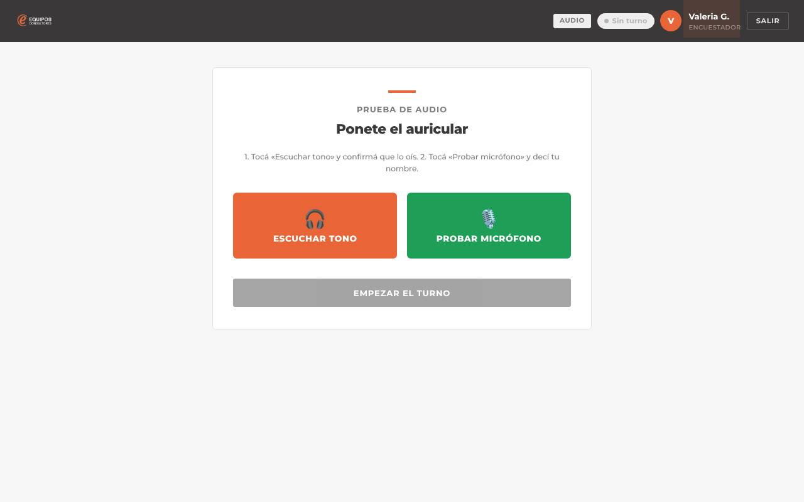
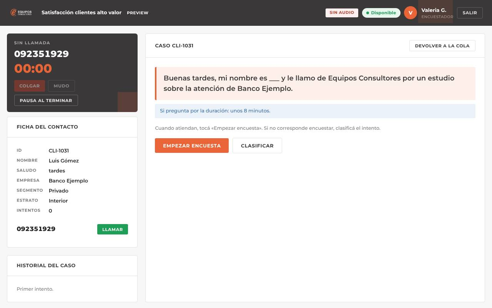
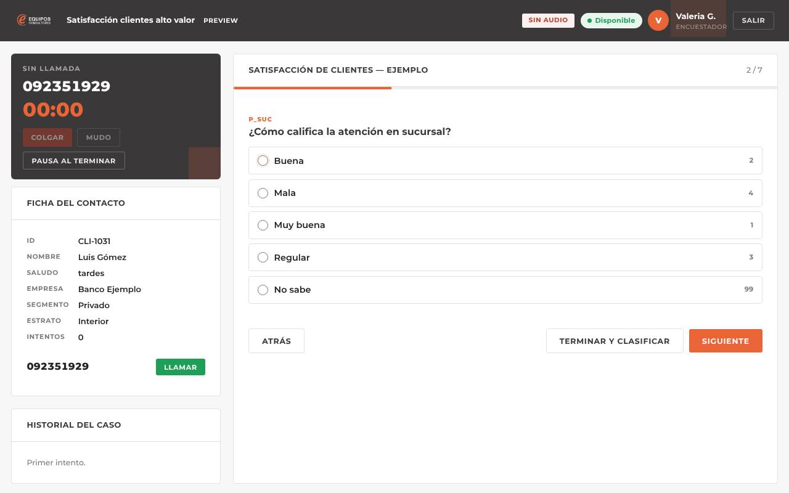
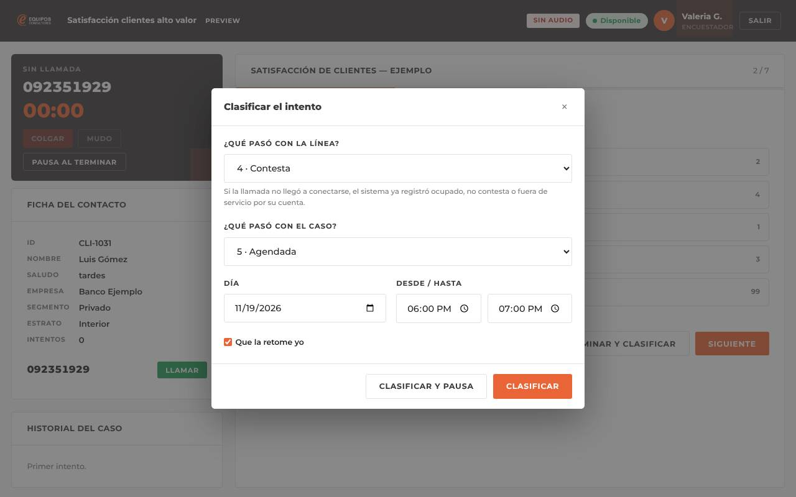
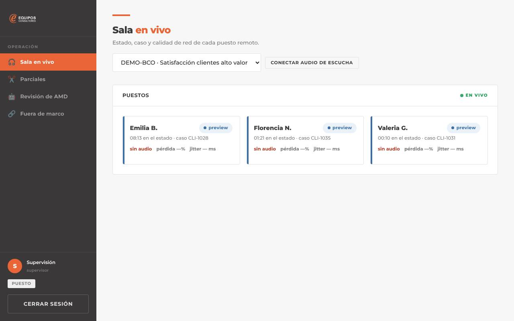
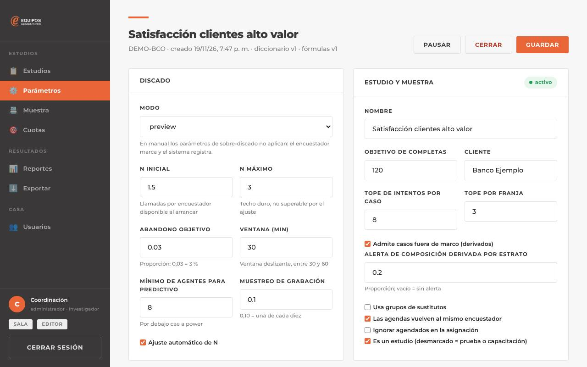
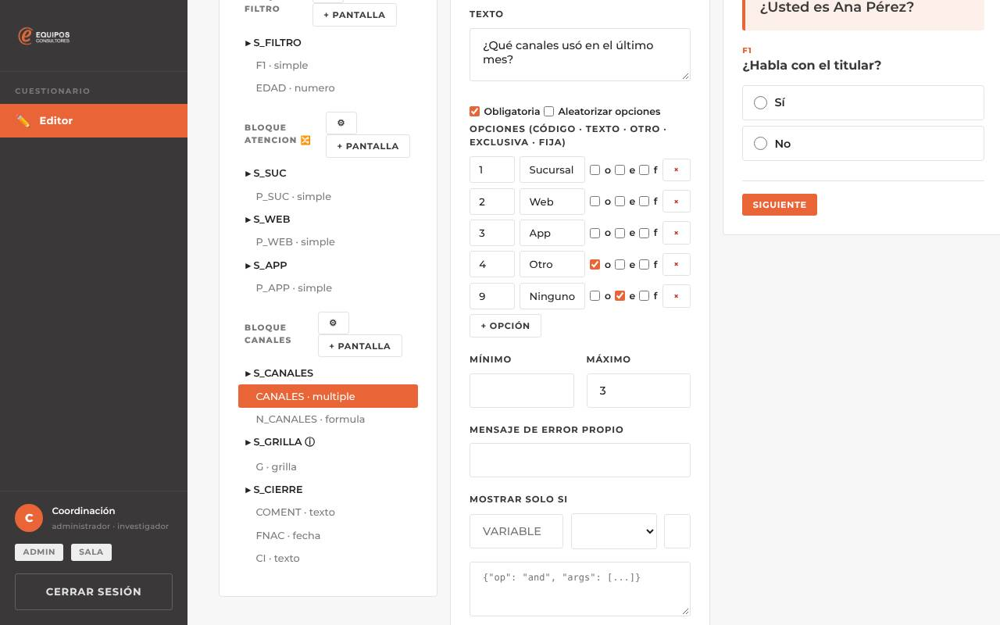
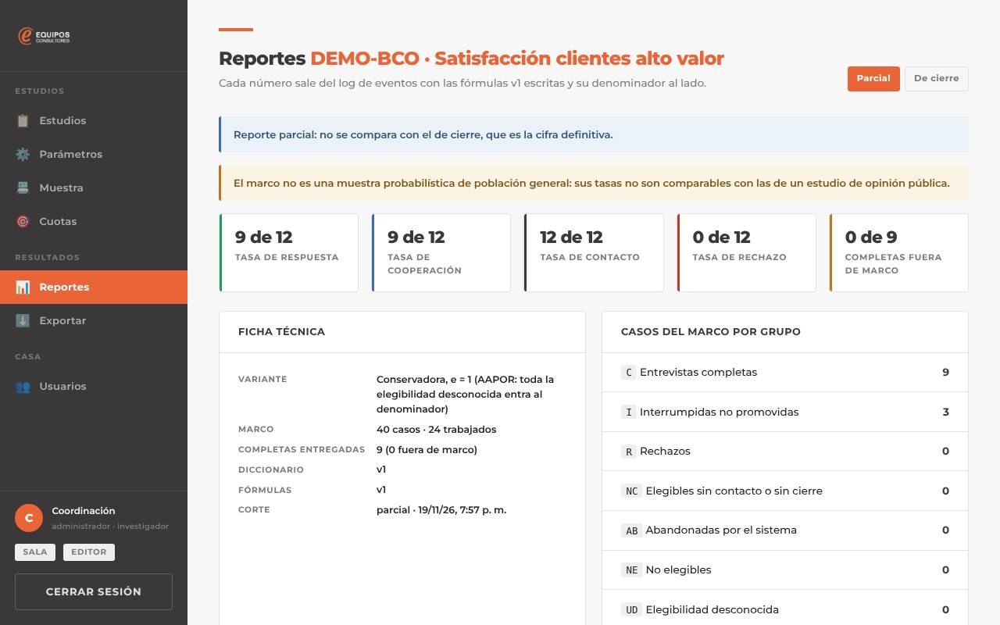

# Manual de uso — INVOKE 2

Nov 19, 2026 · @Equipos

Cómo trabaja cada rol: el encuestador en su puesto remoto, el supervisor en la sala en vivo, el administrador que configura el estudio y el investigador que diseña el cuestionario y lee los reportes.

## Roles y acceso

Todos entran a la misma dirección con su correo y contraseña. Cada uno llega directo a su pantalla.

| Rol | Pantalla | Qué hace |
| --- | --- | --- |
| Encuestador | Puesto | Recibe el caso y el audio juntos, aplica el cuestionario, clasifica y agenda |
| Supervisor | Sala en vivo | Ve quién está y en qué estado, escucha llamadas, controla el discador, promueve parciales y revisa el AMD |
| Administrador | Administración | Crea estudios, elige el modo de discado, carga la muestra, define cuotas y da de alta usuarios |
| Investigador | Administración y editor | Diseña el cuestionario, sigue el avance de cuotas, lee los reportes y exporta |

Una persona puede tener varios roles. En ese caso, la barra lateral muestra accesos a las demás pantallas (Admin, Sala, Editor, Puesto).

**Opus por encuestador.** En **Administración → Usuarios** se puede marcar «Habilitar Opus en su puesto». Por defecto ningún puesto lo tiene: hablan G.711 y el servidor solo puentea el audio. Opus es para una conexión doméstica que lo justifique, porque obliga al servidor a transcodificar. Toma efecto en el próximo inicio de turno.

**Olvidé la contraseña.** Escribí tu correo en el ingreso y tocá «Olvidé mi contraseña»: llega un enlace para crear una nueva. Si tu cuenta existe pero no está habilitada en INVOKE 2, pedí el alta a la coordinación.

## Encuestador

### Antes del turno

Cero instalación: alcanza con el navegador, un auricular USB con micrófono y una conexión estable.

- **Navegador:** Chrome o Edge actualizado. Permití el micrófono cuando lo pida.
- **Auricular:** USB, con micrófono. Elegilo como entrada y salida del sistema antes de entrar.
- **Conexión:** cable o buen Wi-Fi. Evitá descargas o videos en la misma red durante el turno.

Para empezar:

1. Al entrar ves los estudios activos en los que estás asignado. Tocá el del día.
2. **Escuchar tono**: confirmá que lo oís por el auricular.
3. **Probar micrófono**: decí tu nombre en voz normal. Si aparece «No se oyó tu voz», subí el volumen del micrófono en el sistema y repetí.
4. **Empezar el turno**: el puesto conecta el audio. En la barra superior tiene que aparecer **Audio OK**.



**Si dice «Sin audio».** Podés ver la ficha y el cuestionario, pero no se pueden hacer llamadas. Revisá la conexión; el puesto reintenta solo. Si sigue, avisá a la supervisión: ellos ven la calidad de red de tu puesto.

### El turno según el modo de discado

El modo lo elige la administración para cada estudio y figura al lado del nombre del estudio, arriba.

| Modo | Quién llama | Qué hacés vos |
| --- | --- | --- |
| preview | El sistema, cuando vos tocás «Llamar» | Quedás **Disponible** y el caso aparece solo. Leés la ficha y el historial, y tocás **Llamar** en el teléfono que corresponda |
| manual | Vos, con el teclado | Pedí un caso o marcá un número en el **Teclado**. Si el número no está en la muestra, el sistema te pregunta quién es antes de llamar |
| power / predictivo | El sistema, antes de que estés libre | Quedás **Disponible** y esperás. Cuando alguien atiende, su ficha y la primera pantalla aparecen al instante y la llamada ya está conectada |



Lo que ves en el puesto:

- **Barra de llamada** (oscura, arriba a la izquierda): estado, número, tiempo, y los botones **Colgar**, **Mudo** y **Pausa al terminar**.
- **Ficha del contacto**: los datos de la base del cliente y los teléfonos del caso. Un número marcado **No llamar** pidió no ser llamado nunca más, en ningún estudio.
- **Historial**: los intentos anteriores, con su resultado, quién llamó y la nota si la hubo.
- Si el caso dice **derivado**, alguien lo agregó fuera de la muestra original.

**Pausas.** Con **Pausa** dejás de recibir casos. En medio de una llamada no se puede: usá **Pausa al terminar** y quedás en pausa apenas clasifiques. Las horas de sesión se cuentan desde que empezás el turno hasta que salís, así que salí con **Salir** al terminar.

### Durante la entrevista

1. Cuando atiendan y corresponda encuestar, tocá **Empezar encuesta**. En power y predictivo empieza sola.
2. Leé el recuadro naranja tal cual: es el speech, con los datos de la ficha ya reemplazados.
3. Marcá la respuesta y tocá **Siguiente**. Si falta algo o está fuera de rango, aparece en rojo debajo de la pregunta. Algunas preguntas aparecen solo según lo que respondiste antes en la misma pantalla.
4. **Atrás** vuelve a la pantalla anterior sin perder lo respondido. Cambiar una respuesta no borra la anterior: queda registrado el cambio.
5. Al llegar al final, el sistema dice cómo termina la entrevista (por ejemplo **Completa** o **Filtrada**). Confirmalo.



**El orden de las opciones cambia.** Cuando el cuestionario lo pide, las opciones o las pantallas se barajan. Es a propósito, y el orden es siempre el mismo para un mismo caso: si retomás la entrevista, la ves igual.

**Fuera de cuota.** Si una respuesta hace caer el caso en una cuota que ya está completa, aparece el aviso **Fuera de cuota**. Agradecé, despedite y tocá **Cerrar entrevista**: queda clasificada sola.

**Se corta o hay que terminar antes.** Tocá **Terminar y clasificar** y elegí qué pasó. Una entrevista cortada a la mitad queda como **Interrumpida** y pide un motivo. Solo un supervisor puede convertirla en completa.

### Clasificar el intento

Cada intento tiene dos respuestas: qué pasó con la línea y, si contestaron, qué pasó con el caso.



Si la llamada **no llegó a conectarse** (no contesta, ocupado, fuera de servicio, contestador detectado), el sistema la clasifica solo y vos no hacés nada. Si **atendió alguien**, elegí así:

| Situación | Línea | Caso |
| --- | --- | --- |
| Hablaste con la persona y no quiere responder | 4 Contesta | 4 Rechazada |
| Pide que la llamen en otro momento | 4 Contesta | 5 Agendada (día y franja) |
| Se cortó o tuvo que irse a mitad de la entrevista | 4 Contesta | 7 Interrumpida (con motivo) |
| No cumple la condición del estudio (edad, cliente…) | 4 Contesta | 8 No cumple condición (con motivo) |
| La persona falleció | 4 Contesta | 21 Fallecido |
| No es un hogar (empresa, comercio) | 4 Contesta | 22 No es un hogar |
| Atendió un contestador o un fax y lo verificaste vos | 9 Contestador verificado | — |
| Pidió que no lo llamen nunca más | 5 No volver a llamar | — |
| Un mensaje de la compañía dice que el número no existe | 7 Fuera de servicio | — |

**Agendar.** Elegí el día y la franja horaria en que la persona dijo que puede. Con **Que la retome yo** marcado, la llamada vuelve a vos si estás conectado en ese horario. Las agendas con la franja más ajustada se ofrecen primero.

**No vuelvas a llamar a mano a quien el sistema abandonó.** Si alguien atendió en power o predictivo y no había encuestador libre, la llamada queda como abandonada y el caso vuelve más tarde en preview, con la ficha en pantalla. Es para no molestar dos veces a la misma persona.

### Discado manual y números nuevos

Toda llamada pertenece a un caso. Si marcás un número que no está en la muestra, antes de llamar el sistema te pregunta quién es.

| Opción | Ejemplo | Qué hace |
| --- | --- | --- |
| Otro teléfono del mismo caso | «El titular no está, llamalo al celular» | Agrega el número al caso que tenés abierto |
| Persona nueva derivada | «Hablá con mi colega, este es su interno» | Crea un caso nuevo, atribuido a vos, con el caso origen y el motivo. Hay que cerrar el caso actual antes |
| Llamada administrativa | Coordinar, verificar, supervisar | Registra el tiempo, sin disposición. No cuenta como intento |

- El diálogo **no se puede saltear**: es el único momento en que sabés la respuesta.
- Si el estudio no admite casos fuera de marco, la opción «persona derivada» aparece deshabilitada y explica por qué. No clasifiques mal para poder llamar.
- Si el número ya estaba en otro caso de la muestra, el sistema te avisa y no crea un duplicado.

## Supervisor

### Sala en vivo

Con la sala 100% remota, esta consola es el único mecanismo de control. Se actualiza sola; el indicador «en vivo» lo confirma.



| Color del borde | Estado |
| --- | --- |
| Verde | Disponible, esperando caso o llamada |
| Azul | Con un caso en pantalla, todavía sin conectar (preview) |
| Naranja | En llamada |
| Ámbar | Clasificando: la llamada terminó y falta la disposición |
| Gris | En pausa |

**Calidad de red del puesto.** Cada tarjeta muestra la pérdida de paquetes y el jitter de los últimos segundos, si la llamada va por TURN (relay) y el códec. Lo normal es G.711 (PCMA o PCMU): Asterisk solo puentea. Si un puesto habla Opus, la tarjeta dice «transcodifica» y arriba se cuenta cuántos están así: cada uno le suma trabajo al servidor. Con **más de 3 % de pérdida o más de 30 ms de jitter** la tarjeta se marca en rojo: ese encuestador probablemente se oye entrecortado. «Sin audio» quiere decir que el puesto no tiene la conexión de audio levantada.

**Escuchar y susurrar.**

1. Tocá **Conectar audio de escucha** una vez por turno.
2. En una tarjeta en llamada, **Escuchar** te deja oír a las dos partes sin que nadie lo note.
3. **Susurrar** te deja hablarle solo al encuestador; el respondente no te oye.
4. **Dejar** corta la escucha.

**Reparto de frescos y reintentos.** Arriba de los puestos se ve cuántos casos del pool se entregaron hoy, cuántos fueron frescos (nunca llamados) y cuántos reintentos, junto a la proporción configurada en el estudio. Se sortea en cada pedido, así que el efectivo puede diferir del configurado; si se aleja mucho, una de las dos poblaciones se está agotando.

### Discador en power y predictivo

En los estudios con sobre-discado, arriba de los puestos aparecen los indicadores del discador:

- **N vigente**: cuántas llamadas se originan por cada encuestador disponible.
- **Abandono real** en la ventana deslizante (30 a 60 minutos), con su umbral. Incluye los falsos positivos del detector de contestador, así que es la cifra que importa.
- **Abandono reportado**: sin falsos positivos. Siempre es menor o igual al real.
- **Descartadas**: llamadas que el sistema cortó antes de que atendieran porque la sala se vació. No son abandonos.

**Si el abandono real supera el umbral**, bajá N desde la consola con **Fijar N**. Si desmarcás «ajuste automático», el valor queda fijo hasta que lo vuelvas a cambiar. Un abandono quema el caso: es preferible tener encuestadores esperando que números quemados.

### Parciales, AMD y casos derivados

**Promover una parcial.** En **Parciales** están las entrevistas interrumpidas. Una parcial nunca cuenta sola como completa: solo vos podés promoverla, con un motivo, y queda registrado quién lo hizo y cuándo.

**Revisión del detector de contestador (AMD).** El detector a veces confunde a una persona con un contestador y le corta la llamada: es un abandono que no se ve. En **Revisión de AMD** se listan llamadas grabadas que el detector marcó como máquina. Tocá **Escuchar** (la grabación se abre en la consola) y, si era una persona, tocá **Era una persona**. La tasa de error se recalcula y entra en el abandono real. Conviene hacerlo todas las semanas, no una sola vez.

**Casos fuera de marco por encuestador.** Muestra cuántos casos derivados creó cada encuestador y cuántos terminaron en completa, y marca a quien se desvía mucho del resto de la sala. No implica mala fe: es el control normal sobre un procedimiento que crea casos.

**Revisión prioritaria de grabaciones.** En la misma pantalla están las completas de origen fuera de marco, con su grabación: se escuchan antes que el resto.

## Administrador

### Crear y configurar un estudio

1. **Estudios → Nuevo estudio**: código, nombre, cliente, **tipo de marco** y modo de discado. Marcá «prueba o capacitación» si no es un estudio real: así no aparece en ningún reporte.
2. **Parámetros**: completá el objetivo de completas, los topes de intentos, los reintentos y las franjas.
3. **Muestra**: cargá la guía.
4. El investigador publica el **cuestionario** en el editor.
5. **Encuestadores asignados**: marcá quiénes trabajan en el estudio.
6. **Activar**. Un estudio sin cuestionario publicado no se puede activar. Al activarse, quedan fijas las versiones del diccionario y de las fórmulas con las que se va a reportar.



**Tipo de marco y casos fuera de marco.**

| Tipo de marco | Fuera de marco por defecto |
| --- | --- |
| Muestra probabilística de población general | Apagado: cualquier agregado rompe el diseño |
| Base de clientes del cliente | Apagado: el marco es cerrado |
| Empresas o instituciones | Prendido: la derivación interna es parte del trabajo |
| Población difícil de alcanzar | Prendido: el referido puede ser el único camino |

La **alerta de composición derivada** (por estrato) es del estudio. El **tope de casos fuera de marco** es de cada guía: al alcanzarlo, el sistema deja de permitir crear derivados en esa guía.

**Parámetros de discado.**

| Parámetro | Qué controla |
| --- | --- |
| N inicial / N máximo | Llamadas por encuestador disponible al arrancar, y el techo que el ajuste automático no puede superar |
| Abandono objetivo | La tasa de abandono tolerada (0,03 = 3 %). Es del estudio, no del sistema |
| Ajuste automático | Si N se recalcula con la tasa de contacto de la franja o queda fijo |
| Ventana | Minutos de la ventana deslizante del abandono (30 a 60) |
| Mínimo de agentes para predictivo | Con menos encuestadores disponibles que este número, el predictivo trabaja como power |
| Proporción de casos frescos | Probabilidad de que cada pedido de caso salga de los nunca llamados (0,5 = mitad y mitad). Se sortea en cada pedido; si una de las dos poblaciones se agota, se usa la otra |

**Grabación.** Se graban todas las llamadas de encuesta conectadas; las administrativas no. Las grabaciones se suben solas al almacenamiento de la casa y se escuchan desde la consola de supervisión.

**Reintentos y franjas.** Cada resultado reintentable tiene su **espera**, un **tope** opcional y una **ventana**: *misma* (reintenta en la misma franja), *rotar* (siempre en otra franja) o *cualquiera*. Los valores de partida son los del sistema anterior: ocupado 30 min, no contesta y contestador 120 min, fuera de servicio y desconectado 180 min. Además está el tope de intentos por caso y por franja: al alcanzarlo, el caso pasa a no-contacto definitivo.

### Muestra y cuotas

La guía se carga como un CSV con encabezado, separado por coma o punto y coma:

```
telefono;telefono2;identificador;estrato;area;nombre;segmento
099123456;24001234;CLI-1001;Montevideo;2;Ana Pérez;Premium
```

- `telefono` es obligatorio. `telefono2`, `telefono3`… son otros números del mismo caso.
- `identificador`, `estrato` y `area` tienen uso propio. `sustituto` y `grupo_sustituto` arman los grupos de sustitutos.
- Cualquier otra columna va a la **ficha**: se muestra al encuestador, se puede usar en el cuestionario como `{ficha.columna}` y sirve para cuotas por propiedad.
- Las líneas con problemas se informan con su número y el resto se carga igual. También se informa cuántos casos tienen un número en la lista de no llamar.
- Origen **Lista externa**: un agregado que no es parte del diseño. Queda fuera de las tasas del marco y se declara aparte.
- **Semilla del orden aleatorio**: el orden en que se trabajan los casos sale de la semilla y de la fila del archivo. Si la dejás vacía se genera una; queda registrada en la guía. Con la misma semilla y el mismo archivo, el orden es el mismo: sirve para auditar cómo se trabajó la muestra.

**Cuotas.** Una cuota es **por pregunta** (códigos de respuesta), **por propiedad de la ficha** (ej. segmento = Privado) o **por área**, con un objetivo absoluto o un % del objetivo del estudio. Las de ficha y área evitan que el sistema entregue casos que ya no sirven. Las de pregunta se controlan en cada pantalla durante la entrevista. Los casos derivados cuentan para la cuota.

## Investigador

### Editor de cuestionario

El editor produce el mismo documento que ejecuta el puesto. La vista previa usa el mismo motor que el encuestador: lo que ves es lo que va a ver.



**Estructura.**

- **Bloques**: agrupan pantallas. Un bloque con **Aleatorizar** baraja el orden de sus pantallas.
- **Pantallas**: un speech y una o más preguntas. Pueden tener reglas de **flujo** (ir a otra pantalla o terminar con una disposición) y **validaciones** que cruzan respuestas.
- **Preguntas**: simple, múltiple, grilla, texto, número, código, fecha, hora y fórmula. Las opciones pueden ser «otro» (pide especificar), «exclusiva» (como Ns/Nc en una múltiple) o «fija» (no se baraja).

**Condiciones.** «Mostrar solo si» acepta una condición simple (`EDAD >= 18`, `CANALES contiene 1`) o, para lo compuesto, el árbol en JSON:

```json
{"op": "and", "args": [
  {"op": ">=", "args": [{"var": "EDAD"}, 18]},
  {"op": "in", "args": [{"ficha": "segmento"}, "Premium", "Privado"]}
]}
```

Operadores: `== != < <= > >= and or not in contiene vacio cantidad si min max redondear concat + - * /`. No se puede escribir JavaScript: el lenguaje es chico a propósito, para que el navegador y el servidor lo evalúen igual.

**Textos con datos.** En cualquier texto, `{ficha.nombre}` pone un dato de la ficha, `{P1}` el código respondido y `{P1.texto}` la etiqueta de la opción elegida.

**Guardar y publicar.** **Guardar borrador** valida contra el esquema y guarda sin afectar al campo. **Publicar** crea una versión que ya no se modifica: las entrevistas quedan atadas a ella, y los cambios posteriores abren una versión nueva. También se puede importar y exportar el JSON.

### Reportes

Cada número sale de los hechos registrados, con las fórmulas del documento de fórmulas v1, y siempre con su denominador al lado.



**Parcial o de cierre.** Un reporte **parcial** es de un estudio abierto: los casos sin resolver aparecen «en proceso» y no entran en las tasas. El de **cierre** se pide con el estudio cerrado y es la cifra definitiva. Los dos no se comparan entre sí.

| Tasa | Fórmula | Para qué |
| --- | --- | --- |
| Respuesta | `C / (C + I + R + NC + AB + UD)` | Lo que se declara al cliente (variante conservadora, e = 1) |
| Cooperación | `C / (C + I + R)` | Calidad del contacto y del speech |
| Contacto | `(C + I + R + NE) / (C + I + R + NC + AB + NE + UD)` | Con cuántos casos se habló |
| Rechazo | `R / (C + I + R + NC + AB + UD)` | Mismo denominador que la respuesta |

Con menos de 30 casos en el denominador, la tasa se muestra como «x de y» y no como porcentaje: un «50 %» que en realidad es uno de dos no informa nada.

**Evaluar encuestadores.** Nunca con la tasa de respuesta, que depende de la muestra que le tocó a cada uno. Usá la **cooperación** y las **completas por hora** juntas, en la tabla de productividad. Una sola de las dos empuja a la sala en la dirección equivocada.

**Fuera de marco.** Las completas de casos derivados o de listas externas **se entregan**, pero no participan de las tasas del marco ni del análisis ponderado. El reporte las muestra aparte, por origen, y alerta cuando un estrato supera el umbral de composición derivada.

**Exportar.** SPSS (.sav), Excel o CSV. Cada registro trae `origen`, `caso_origen`, el grupo de cálculo, las disposiciones y la variable `ponderable` (0 para fuera de marco). Las preguntas múltiples salen como una variable 0/1 por opción y las grillas como una variable por fila. El .sav lleva etiquetas de variable y de valor.

## Glosario de disposiciones

Diccionario v1. La definición completa está en `Diccionario de disposiciones — INVOKE 2.md`.

| Teléfono | Etiqueta |
| --- | --- |
| 3 | Ocupado |
| 4 | Contesta |
| 5 | No volver a llamar |
| 6 | No contesta |
| 7 | Fuera de servicio |
| 8 | Desconectado |
| 9 | Contestador verificado |
| 30 | Abandonada por el sistema |
| 31 | Contestador detectado por el sistema |
| 32 | Falso positivo de contestador |

| Encuesta | Etiqueta | Grupo |
| --- | --- | --- |
| 3 | Completa | C |
| 4 | Rechazada | R |
| 5 | Agendada | NC |
| 6 | Fuera de Cuota | NC |
| 7 | Interrumpida | I |
| 8 | No cumple condición | NE |
| 20 | Filtrada | NE |
| 21 | Fallecido | NE |
| 22 | No es un hogar | NE |
| 50 | No aplica | NE |

Grupos: C completas · I interrumpidas no promovidas · R rechazos · NC elegibles sin contacto o sin cierre · AB abandonadas por el sistema · NE no elegibles · UD elegibilidad desconocida.

## Preguntas frecuentes

**¿Por qué no me llega ningún caso?** Puede que estés en pausa, que el estudio ya haya llegado a su objetivo, que todos los casos estén esperando su próximo reintento o que las cuotas de la ficha estén llenas. La supervisión ve el estado de tu puesto en la sala.

**¿Puedo cambiar una disposición que puse mal?** No desde el puesto: lo registrado es un hecho y no se edita. Avisale a la supervisión, que puede aplicar los estados extendidos (Recall, Retomar, Corregir) o promover una parcial.

**¿Por qué el reporte de hoy dice otra cosa que el de ayer?** Si el estudio sigue abierto, es un reporte parcial y cambia a medida que se resuelven casos. Si pedís el mismo corte en el tiempo, el número es exactamente el mismo.

**¿Qué pasa si se cae mi conexión en medio de una llamada?** El audio se corta y el puesto reconecta solo. El caso sigue asignado a vos: al volver, clasificá el intento.
